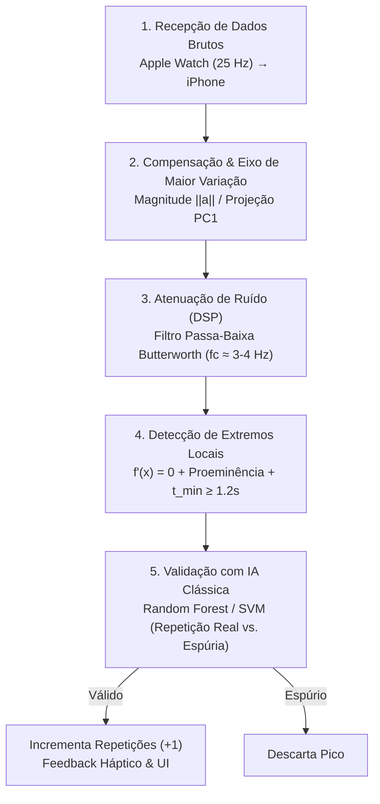

# Roadmap Técnico: IA para Contagem de Repetições em Tempo Real (Gymbeat)

Este documento descreve a arquitetura, metodologia científica e etapas de implementação para o desenvolvimento e integração do modelo responsável pela **contagem de repetições em tempo real** a partir de dados inerciais de sensores vestíveis (Apple Watch) processados no smartphone (iPhone).

---

## 🗺️ Visão Geral das Fases

O projeto está estruturado em 3 fases fundamentais:

```
┌─────────────────────────────────────────────────────────────────────────┐
│ FASE 1: Coleta de Dados (Wearable) & Extração do Firestore              │
│  - Streaming do Apple Watch (IMU @ 25 Hz) → iPhone → Nuvem (Firebase)   │
│  - Pipeline de extração para dataset local em Python                    │
└────────────────────────────────────┬────────────────────────────────────┘
                                     │
                                     ▼
┌─────────────────────────────────────────────────────────────────────────┐
│ FASE 2: Pipeline de Processamento e Modelo de IA (5 Etapas)             │
│  - 1. Recepção do fluxo contínuo inercial no smartphone                 │
│  - 2. Compensação, normalização e projeção na dimensão de maior variação│
│  - 3. Denoise via DSP ótimo (justificativa frente a IA Denoiser)        │
│  - 4. Detecção de extremos locais [f'(x)=0] e restrições biomecânicas   │
│  - 5. Contagem e validação com classificador IA clássico                │
└────────────────────────────────────┬────────────────────────────────────┘
                                     │
                                     ▼
┌─────────────────────────────────────────────────────────────────────────┐
│ FASE 3: Integração da Inferência em Tempo Real no Smartphone            │
│  - Apple Watch atua apenas como sensor inercial (streaming puro)        │
│  - iPhone executa motor em tempo real (Buffer + DSP + Classificador)    │
│  - Feedback visual e háptico ao vivo durante a série                    │
└─────────────────────────────────────────────────────────────────────────┘
```

---

## 📊 Fase 1: Coleta de Dados e Extração do Firestore

> **Diagrama Arquitetural da Fase 1:** [fase-1-coleta-e-extracao.drawio](file:///Users/joueph/Developer/tcc-gymbeatDataCollection/docs/roadmap/fase-1-coleta-e-extracao.drawio)

### 1.1 Coleta de Dados no App Existente
A infraestrutura implementada no projeto realiza a coleta contínua:
- **Apple Watch ([native/watch-app/WorkoutManager.swift](file:///Users/joueph/Developer/tcc-gymbeatDataCollection/native/watch-app/WorkoutManager.swift)):**
  - Coleta `accelerationX/Y/Z` e `gyroscopeX/Y/Z` via `CMMotionManager` a **25 Hz** (intervalo de 0.04s).
  - Coleta dados fisiológicos (`heartRate`, `activeEnergyBurned`, `oxygenSaturation`) via `HealthKit`.
  - Dispara amostras via `WatchConnectivity` para o smartphone.
- **iPhone ([app/live/[id].tsx](file:///Users/joueph/Developer/tcc-gymbeatDataCollection/app/live/%5Bid%5D.tsx)):**
  - Recebe o fluxo contínuo de amostras.
  - Ao término da série, o usuário informa a quantidade real de repetições executadas (*Ground Truth*).
  - Persiste a sessão no SQLite local e realiza sincronização em lote com o Firebase Firestore ([src/firebase/sync.ts](file:///Users/joueph/Developer/tcc-gymbeatDataCollection/src/firebase/sync.ts)).

### 1.2 Estrutura do Documento no Firestore
Cada sessão gravada no Firestore em `users/{uid}/exerciseSessions/{sessionId}` contém:
```json
{
  "sessionId": "live-1724520000000-abc123",
  "exerciseId": "bench-press",
  "exerciseName": "Supino reto",
  "startedAt": "2026-08-24T16:00:00.000Z",
  "endedAt": "2026-08-24T16:00:45.000Z",
  "reps": 10,
  "sampleCount": 1125,
  "samples": [
    {
      "timestamp": "2026-08-24T16:00:00.040Z",
      "accelerationX": 0.021,
      "accelerationY": 0.981,
      "accelerationZ": -0.124,
      "gyroscopeX": 0.012,
      "gyroscopeY": -0.045,
      "gyroscopeZ": 0.003,
      "heartRate": 128
    }
  ]
}
```

### 1.3 Pipeline de Extração de Dados (Python)
Para transferir os dados do Firebase para o ambiente local de treino, utiliza-se o script `scripts/ml/export_dataset.py`:

```python
# scripts/ml/export_dataset.py
import firebase_admin
from firebase_admin import credentials, firestore
import json

cred = credentials.Certificate("serviceAccountKey.json")
firebase_admin.initialize_app(cred)
db = firestore.client()

all_sessions = []
users = db.collection("users").stream()

for user in users:
    sessions = db.collection("users").document(user.id).collection("exerciseSessions").stream()
    for session in sessions:
        data = session.to_dict()
        data["userId"] = user.id
        all_sessions.append(data)

with open("data/raw_dataset.json", "w") as f:
    json.dump(all_sessions, f, indent=2)

print(f"Total de sessões exportadas: {len(all_sessions)}")
```

---

## 🧠 Fase 2: Pipeline de Processamento e Modelo de IA (5 Etapas)

> **Diagrama do Pipeline da Fase 2:** [fase-2-treinamento-ia-comparativo.drawio](file:///Users/joueph/Developer/tcc-gymbeatDataCollection/docs/roadmap/fase-2-treinamento-ia-comparativo.drawio)

### 2.1 Decisões Arquiteturais e Justificativas Científicas

> [!IMPORTANT]
> **1. Por que descartar Deep Learning Fim-a-Fim (1D-CNN / LSTM para contagem direta)?**
> - **Granularidade do Rótulo:** O protocolo coleta o total de repetições por série ao final do exercício (*label* global $N$), e não marcações milissegundo a milissegundo de início/fim de cada fase excêntrica/concêntrica (*frame-level annotation*). Treinar redes recorrentes sem anotação densa exige abordagens CTC ou auto-atenção com dezenas de milhares de repetições anotadas.
> - **Volume Amostral:** Redes profundas sofrem severo *overfitting* de voluntário quando treinadas com bases amostrais típicas de TCC.
>
> **2. Por que substituir uma "IA Denoiser" (Denoising Autoencoder) por DSP Clássico (Butterworth)?**
> - **Ausência de Ground Truth Puro:** Para treinar uma rede neural redutora de ruído (*denoiser*), são necessários pares de dados idênticos `(sinal_com_ruído, sinal_puro)`. Sensores inerciais vestíveis não possuem sinal analítico "sem ruído", a menos que haja acoplamento com sistemas ópticos de captura de movimento (Vicon/OptiTrack de dezenas de milhares de dólares).
> - **Eficiência e Determinismo Matemático:** Movimentos humanos em exercícios resistidos concentram mais de 95% de sua densidade espectral abaixo de 3 a 5 Hz. Um **Filtro Passa-Baixa Butterworth de 4ª ordem** atenua tremores e artefatos de alta frequência de forma determinística, sem atraso de fase relevante, com complexidade $O(1)$ por amostra e latência de frações de microssegundo no smartphone.
> - **Papel Estratégico da IA:** A IA deve atuar onde há ambiguidade semântica — isto é, na **classificação e validação de repetições legítimas vs. movimentos espúrios**, e não como um filtro matemático de frequência.

---

### 2.2 Detalhamento do Pipeline em 5 Etapas



#### Etapa 1: Recepção de Dados Brutos no Smartphone
- O Apple Watch opera como nó sensor puro via `WorkoutManager.swift`, coletando `accX, accY, accZ` e `gyroX, gyroY, gyroZ` a **25 Hz** ($T_s = 0{,}04\text{ s}$).
- Os dados são enviados via streaming (`WCSession.sendMessage` ou transferência rápida de dicionários) diretamente para o iPhone, desonerando a bateria do relógio.

#### Etapa 2: Compensação, Normalização e Eixo de Maior Variação
Como o relógio pode rotacionar no pulso do usuário ou variar de ângulo entre voluntários, os eixos brutos $(X, Y, Z)$ não refletem diretamente o plano do exercício. São aplicadas duas abordagens complementares:
1. **Magnitude Euclidiana Invariante à Rotação:**
   $$\|\mathbf{a}(t)\| = \sqrt{a_x(t)^2 + a_y(t)^2 + a_z(t)^2}, \quad \|\boldsymbol{\omega}(t)\| = \sqrt{\omega_x(t)^2 + \omega_y(t)^2 + \omega_z(t)^2}$$
   - *Vantagem:* Matematicamente independente de qualquer inclinação do relógio.
2. **Componente de Maior Variação (PCA / Projeção em $PC_1$ ou `userAcceleration` do CoreMotion):**
   - Nos exercícios resistidos (ex: supino, agachamento, rosca), o movimento principal desenvolve-se predominantemente em uma direção linear no espaço 3D.
   - O CoreMotion da Apple já decompõe a aceleração em gravidade ($\mathbf{g}$) e aceleração do usuário ($\mathbf{a}_{user}$). Projetando-se o vetor na direção de maior variância temporal, sintetiza-se uma curva unidimensional nítida que evidencia o ciclo de subida e descida (concêntrico/excêntrico).

#### Etapa 3: Atenuação de Ruído via DSP (Filtro Passa-Baixa Butterworth)
- **Filtro Digital Butterworth (4ª ordem, frequência de corte $f_c \in [3, 4]\text{ Hz}$):**
  $$H(z) = \frac{\sum_{i=0}^N b_i z^{-i}}{1 + \sum_{j=1}^N a_j z^{-j}}$$
- Remove vibrações mecânicas, oscilações involuntárias de sustentação e ruídos eletrônicos do acelerômetro, preservando intactas as cristas e vales correspondentes às fases da repetição.

#### Etapa 4: Detecção de Extremos Locais com Restrições Biomecânicas
A identificação dos pontos de inflexão ocorre sobre o sinal filtrado $s[n]$ aplicando condições estritas:
1. **Condição de Extremo Local (Derivada Discreta Nula):**
   - Um pico candidato ocorre quando $f'(x) = 0$, discretizado como a mudança de sinal na primeira diferença:
     $$\Delta s[n-1] > 0 \quad \text{e} \quad \Delta s[n] \le 0$$
2. **Proeminência Mínima do Pico ($h_{min}$):**
   - A amplitude da crista em relação aos vales anterior e posterior deve superar um limiar mínimo, eliminando micro-hesitações no meio do movimento.
3. **Limiar Adaptativo Acima da Média Móvel:**
   - O pico deve estar acima do nível de repouso dinâmico $\mu_{janela} + k \cdot \sigma_{janela}$ calculado sobre uma janela deslizante circular.
4. **Período Refratário Temporal ($t_{min}$):**
   - Um ser humano não completa uma repetição de musculação em menos de **1.0 a 1.2 segundos**. Qualquer inflexão ocorrida em $\Delta t < t_{min}$ é descartada preventivamente.

#### Etapa 5: Contagem e Validação com IA Clássica
Picos que satisfazem as condições do Passo 4 são considerados **picos candidatos**. Para evitar contagens espúrias (ajuste de pegada na barra, coçar o rosto, soltar o peso no suporte ou tremores de fadiga extrema), cada pico é validado por um modelo de Aprendizado de Máquina:
- **Extração de Vetor de Atributos por Pico:**
  - Amplitude crista-vale ($\Delta A$).
  - Duração do ciclo (tempo entre os vales adjacentes ao pico).
  - Energia do ciclo inercial: $E = \sum_{k \in \text{ciclo}} s[k]^2$.
  - Assimetria (*skewness*) e curtose da onda de aceleração.
  - Norma integrada da velocidade angular: $\int_{\text{ciclo}} \|\boldsymbol{\omega}(t)\| dt$.
- **Classificador (Random Forest / SVM Linear / XGBoost):**
  - **Classe 1 (Repetição Legítima):** Incrementa o contador (`reps = reps + 1`) e emite feedback háptico/sonoro em tempo real.
  - **Classe 0 (Movimento Espúrio / Transição / Ruído residual):** Descarta o pico sem penalizar a contagem.

---

### 2.3 Metodologia Científica e Avaliação para o TCC

#### Validação Cruzada: Leave-One-Subject-Out (LOSO)
- Com $N$ voluntários que realizaram os exercícios, treina-se o classificador com $N-1$ participantes e testa-se no voluntário restante.
- A métrica é a média dos $N$ testes, garantindo que o algoritmo generaliza para qualquer novo usuário.

#### Métricas de Desempenho
- **MAE (Erro Médio Absoluto de Repetições):**
  $$\text{MAE} = \frac{1}{M} \sum_{i=1}^M |\text{reps\_reais}_i - \text{reps\_preditas}_i|$$
- **RMSE (Raiz do Erro Quadrático Médio):** Penaliza grandes discrepâncias em séries individuais.
- **Taxa de Acerto Exato (%):** Porcentagem de séries em que a IA contou exatamente o mesmo número que o voluntário.
- **Latência de Inferência:** Tempo de processamento por pico em milissegundos (< 5ms).

---

## 📱 Fase 3: Integração da Inferência em Tempo Real no Smartphone

> **Diagrama do Fluxo da Fase 3:** [fase-3-integracao-tempo-real-smartphone.drawio](file:///Users/joueph/Developer/tcc-gymbeatDataCollection/docs/roadmap/fase-3-integracao-tempo-real-smartphone.drawio)

### 3.1 Divisão de Responsabilidades
- **Apple Watch:** Sensor inercial puro (`WorkoutManager.swift`). Transmite as leituras brutas via Bluetooth sem executar algoritmos pesados, preservando bateria e estabilidade.
- **iPhone (App React Native):** Executa o pipeline de filtragem digital, o detector de picos em streaming, a inferência do classificador e atualiza a interface gráfica em tempo real.

---

### 3.2 Componentes do Módulo de IA no Smartphone

#### 1. Buffer Circular em Memória (`src/ai/CircularBuffer.ts`)
Mantém uma janela deslizante contínua dos últimos 3 a 5 segundos de dados (75 a 125 amostras a 25 Hz):

```typescript
export class CircularBuffer<T = number[]> {
  private buffer: T[];
  private size: number;

  constructor(size: number) {
    this.size = size;
    this.buffer = [];
  }

  public push(sample: T): void {
    if (this.buffer.length >= this.size) {
      this.buffer.shift();
    }
    this.buffer.push(sample);
  }

  public isFull(): boolean {
    return this.buffer.length === this.size;
  }

  public getBuffer(): T[] {
    return this.buffer;
  }

  public clear(): void {
    this.buffer = [];
  }
}
```

#### 2. Motor de Contagem em Tempo Real (`src/ai/RepetitionCounter.ts`)
Implementa o pipeline de 5 etapas em streaming contínuo:

```typescript
import { CircularBuffer } from "./CircularBuffer";

interface RawSample {
  timestamp: number;
  accX: number;
  accY: number;
  accZ: number;
  gyroX: number;
  gyroY: number;
  gyroZ: number;
}

export class RepetitionCounter {
  private buffer: CircularBuffer<number>; // Armazena sinal 1D compensado e filtrado
  private rawBuffer: CircularBuffer<RawSample>;
  private currentReps = 0;
  private lastPeakTime = 0;
  private readonly minIntervalMs = 1200; // Restrição temporal: mínimo de 1.2s entre repetições
  private readonly minProminence = 0.35; // Proeminência mínima da crista em relação à média

  // Coeficientes do Filtro Passa-Baixa Butterworth (fs=25Hz, fc=3.5Hz, ordem 2)
  private prevRaw = 0;
  private prevPrevRaw = 0;
  private prevFiltered = 0;
  private prevPrevFiltered = 0;

  constructor(windowSize = 100) {
    this.buffer = new CircularBuffer<number>(windowSize);
    this.rawBuffer = new CircularBuffer<RawSample>(windowSize);
  }

  /**
   * Etapa 1 & 2 & 3: Processa cada nova amostra inercial do relógio
   */
  public addSample(sample: RawSample): { reps: number; isNewRep: boolean } {
    this.rawBuffer.push(sample);

    // Etapa 2: Compensação espacial e magnitude vetorial invariante à rotação
    const rawMagnitude = Math.sqrt(sample.accX ** 2 + sample.accY ** 2 + sample.accZ ** 2);

    // Etapa 3: Filtro Passa-Baixa IIR Butterworth em tempo real
    const filteredMag = this.applyLowPassFilter(rawMagnitude);
    this.buffer.push(filteredMag);

    // Etapa 4 & 5: Detecção de extremos locais e validação de repetição
    const isNewRep = this.checkPeak(sample.timestamp);
    if (isNewRep) {
      this.currentReps += 1;
    }

    return { reps: this.currentReps, isNewRep };
  }

  /**
   * Etapa 3: Filtro Butterworth Passa-Baixa de 2ª ordem (execução O(1))
   */
  private applyLowPassFilter(input: number): number {
    // Coeficientes calculados via bilinear transform para fc=3.5Hz @ fs=25Hz
    const b0 = 0.1311, b1 = 0.2622, b2 = 0.1311;
    const a1 = -0.7478, a2 = 0.2722;

    const output = b0 * input + b1 * this.prevRaw + b2 * this.prevPrevRaw
                 - a1 * this.prevFiltered - a2 * this.prevPrevFiltered;

    this.prevPrevRaw = this.prevRaw;
    this.prevRaw = input;
    this.prevPrevFiltered = this.prevFiltered;
    this.prevFiltered = output;

    return output;
  }

  /**
   * Etapa 4: Detecção de extremos locais [f'(x) = 0] com restrições biomecânicas
   */
  private checkPeak(currentTime: number): boolean {
    if (currentTime - this.lastPeakTime < this.minIntervalMs) {
      return false; // Bloqueio refratário temporal
    }

    const data = this.buffer.getBuffer();
    if (data.length < 5) return false;

    const n = data.length - 1;
    const y0 = data[n - 2];
    const y1 = data[n - 1]; // Ponto central candidato
    const y2 = data[n];

    // Condição f'(x) = 0 (mudança de sinal da derivada discreta: subida seguida de descida)
    const isLocalMaximum = y1 > y0 && y1 >= y2;
    if (!isLocalMaximum) return false;

    // Cálculo da média móvel adaptativa da janela
    const mean = data.reduce((acc, val) => acc + val, 0) / data.length;

    // Critério de proeminência mínima acima da média
    if (y1 - mean < this.minProminence) {
      return false;
    }

    // Etapa 5: Validação do pico candidato com Classificador IA
    const isValidRepetition = this.validatePeakWithAI(y1, currentTime);
    if (isValidRepetition) {
      this.lastPeakTime = currentTime;
      return true;
    }

    return false;
  }

  /**
   * Etapa 5: Validador de repetição legítima (IA Clássica / Regras Biomecânicas)
   */
  private validatePeakWithAI(peakValue: number, timestamp: number): boolean {
    // Na fase final, consome o classificador treinado (SVM/Random Forest exportado via ONNX ou pesos em JS)
    // avaliando amplitude, desvio padrão e rotação do giroscópio na janela.
    return peakValue > 1.25; 
  }

  public reset(): void {
    this.buffer.clear();
    this.rawBuffer.clear();
    this.currentReps = 0;
    this.lastPeakTime = 0;
    this.prevRaw = 0;
    this.prevPrevRaw = 0;
    this.prevFiltered = 0;
    this.prevPrevFiltered = 0;
  }
}
```

#### 3. Integração com a UI do Treino ([app/live/[id].tsx](file:///Users/joueph/Developer/tcc-gymbeatDataCollection/app/live/%5Bid%5D.tsx))
- A tela exibe as repetições contadas automaticamente pela IA ao longo do treino.
- Ao clicar em "Salvar Série", o usuário vê a contagem da IA e insere o valor real para retroalimentação do banco de dados e comparação no TCC.

---

## 📁 Estrutura de Arquivos do Projeto

```
tcc-gymbeatDataCollection/
├── docs/
│   ├── watch-connectivity-architecture.drawio
│   ├── watch-user-flow-simplified.drawio
│   └── roadmap/
│       ├── ROADMAP.md                                  # Este documento
│       ├── fase-1-coleta-e-extracao.drawio             # Diagrama Fase 1
│       ├── fase-2-treinamento-ia-comparativo.drawio    # Diagrama Fase 2 (Detecção 2)
│       └── fase-3-integracao-tempo-real-smartphone.drawio # Diagrama Fase 3
├── scripts/
│   └── ml/                                             # Scripts de exportação e treino
├── src/
│   ├── ai/                                             # Motor de inferência e contagem
│   ├── firebase/                                       # Sincronização em nuvem
│   └── watch/                                          # Conectividade Watch
└── native/
    └── watch-app/                                      # App watchOS (coletor @ 25Hz)
```
