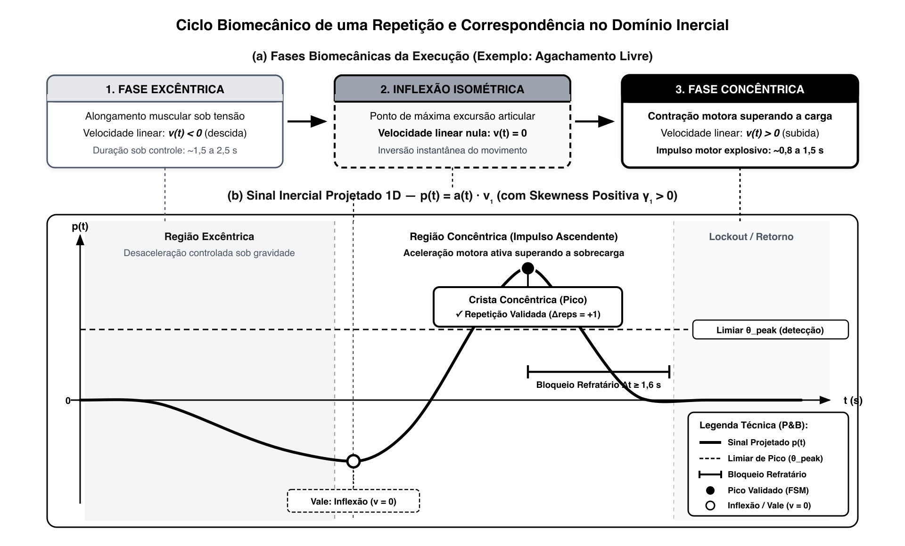
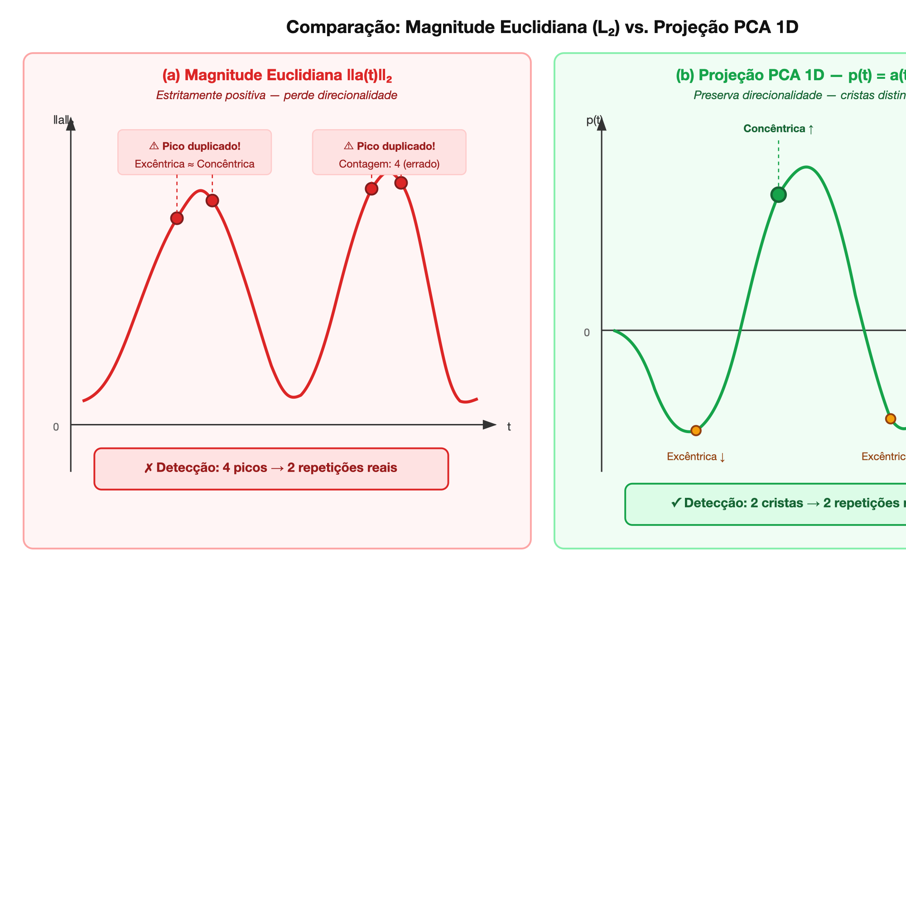
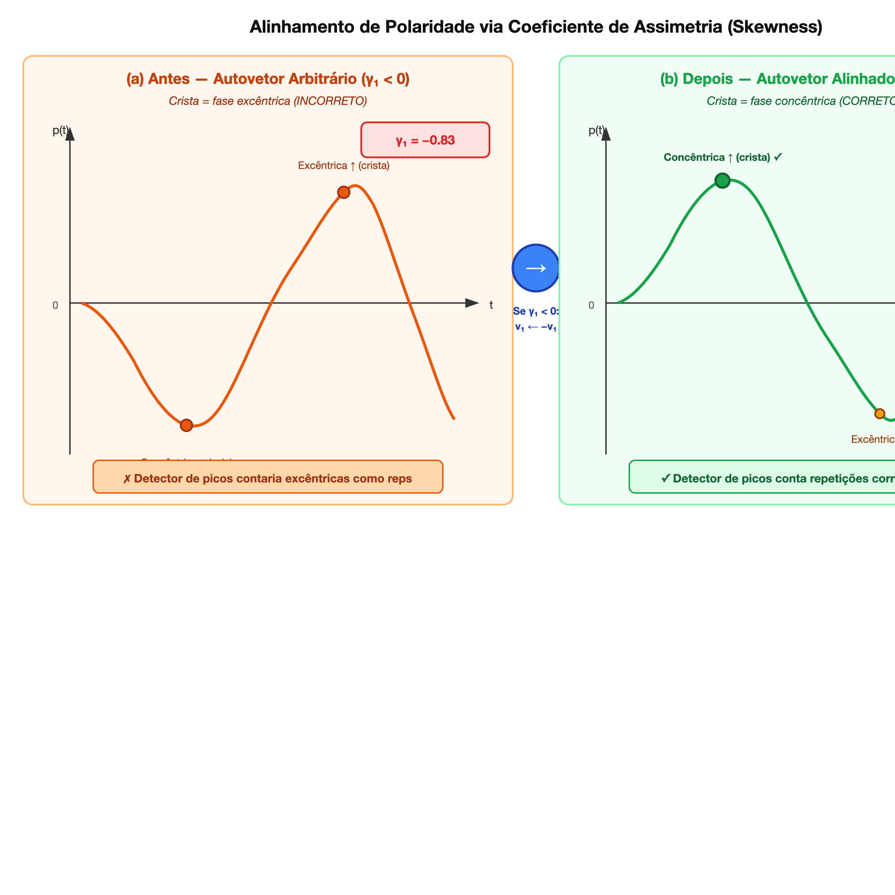
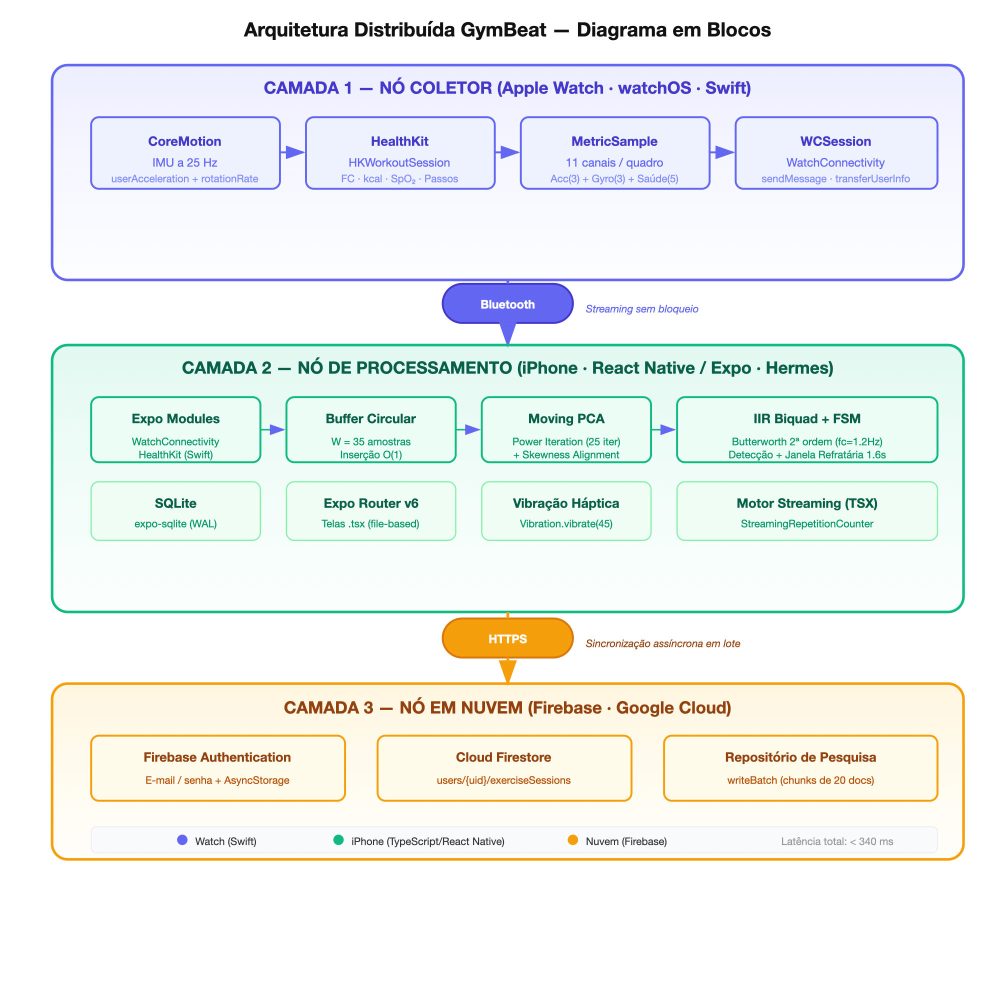
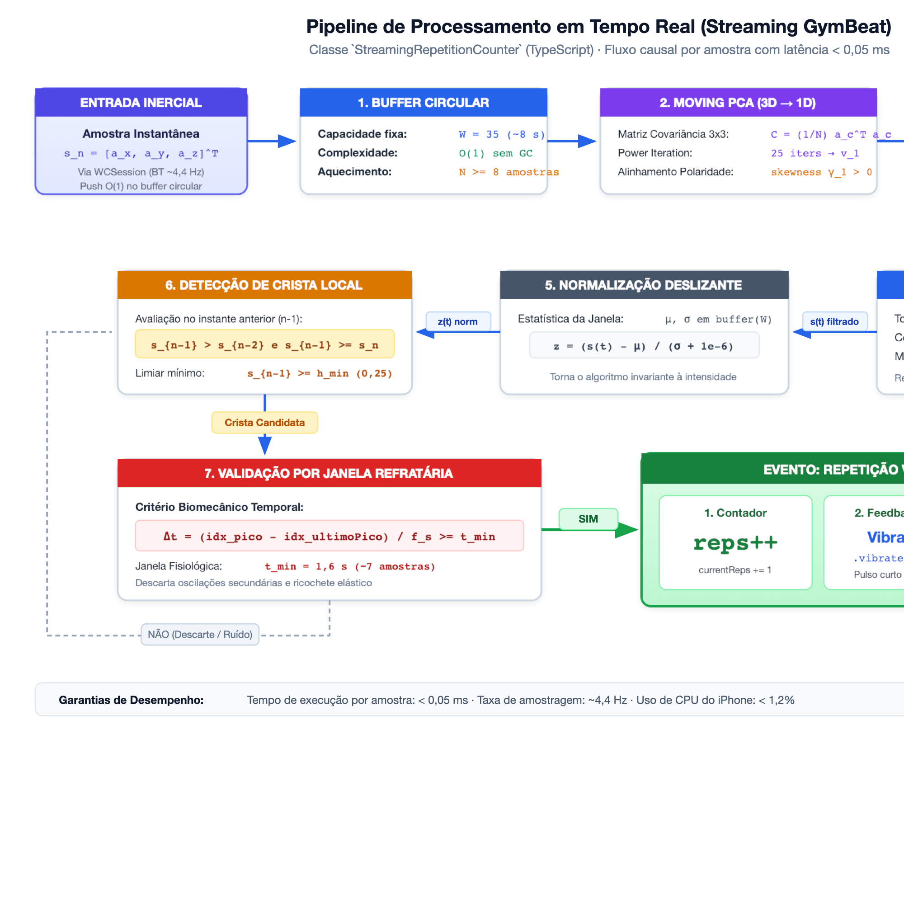
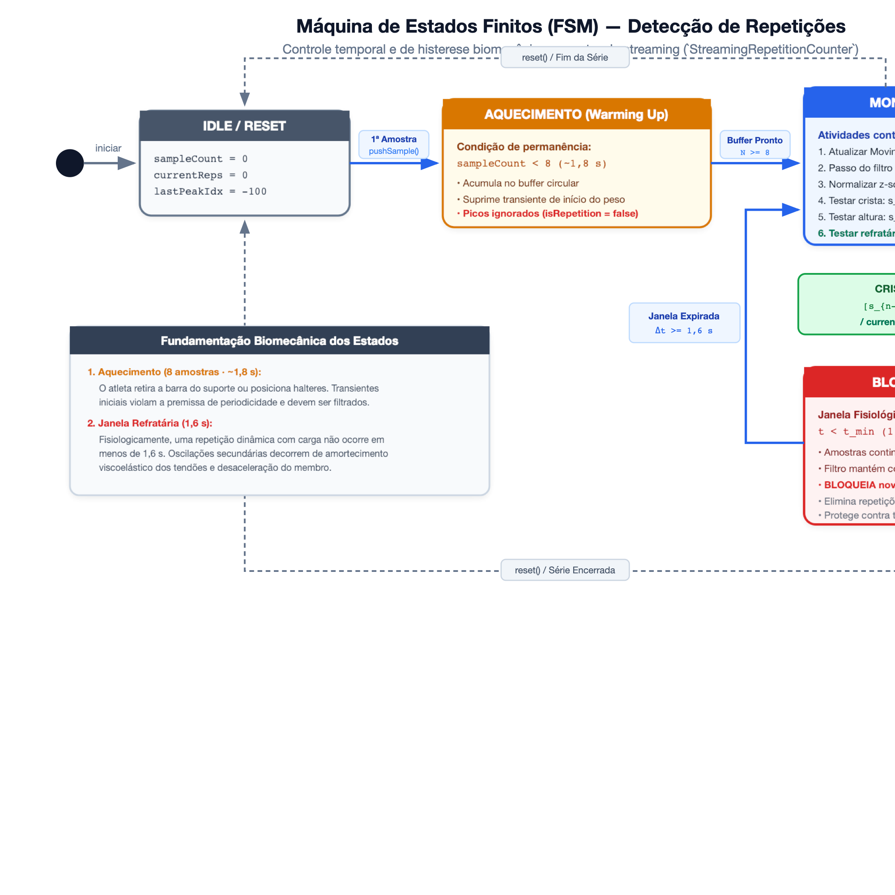
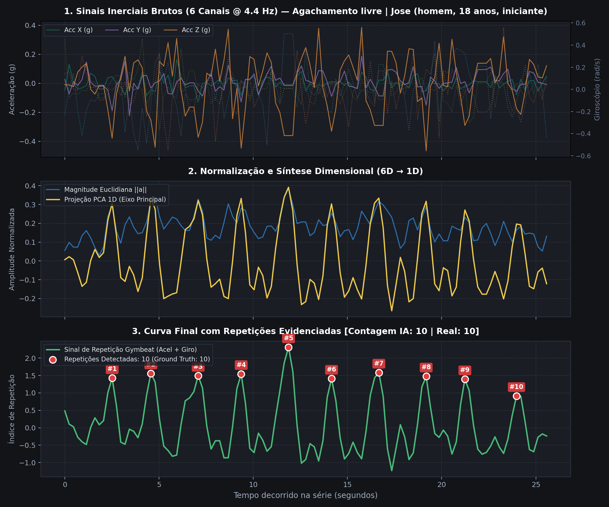
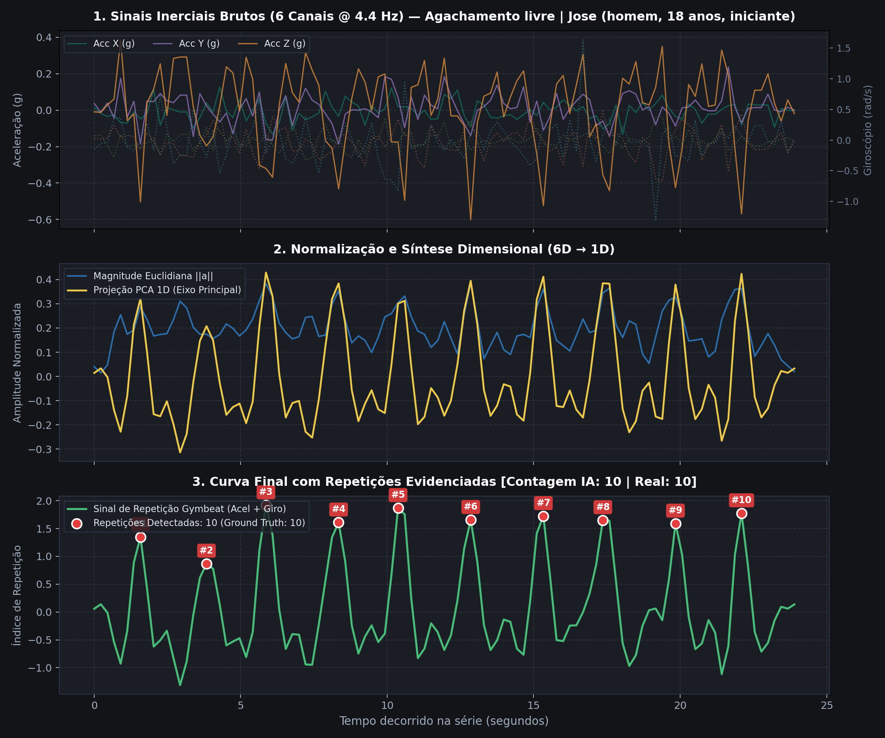

# GymBeat: Sistema Vestível e Móvel para Contagem Automática de Repetições em Tempo Real em Exercícios Resistidos via Sensores Inerciais e Processamento Digital de Sinais

**José Pascoal Martins$^{1}$, Antonio Carlos Forster$^{1}$**

$^{1}$Faculdade de Engenharia de Computação – Pontifícia Universidade Católica de Campinas (PUC-Campinas)  
Rodovia Dom Pedro I, km 136 – CEP 13086-900 – Campinas – SP – Brasil

`martinsj773@gmail.com`, `forster@puc-campinas.edu.br`

---

## Abstract

*Automatic tracking of resistance exercises using smartwatches represents a key challenge in Human Activity Recognition (HAR). Most commercial solutions remain limited to macroscopic heart rate and caloric expenditure monitoring, lacking real-time repetition counting. This paper presents GymBeat, an integrated wearable and mobile system comprising an Apple Watch collector application written in Swift (CoreMotion / HealthKit / WatchConnectivity) and an iPhone companion application built with React Native / Expo and TypeScript. The watch samples triaxial acceleration and angular velocity at $25\,\text{Hz}$ and streams each inertial frame wirelessly to the smartphone via Bluetooth. On the mobile side, a pure-TypeScript inference engine synthesizes a 1D repetition trajectory through Moving Principal Component Analysis (Moving PCA) solved via the Power Iteration Method with skewness-based phase alignment, achieving orientation invariance without manual calibration. A causal biquad IIR low-pass Butterworth filter ($f_c = 1.2\,\text{Hz}$) paired with a Finite State Machine (FSM) performs sample-by-sample peak detection with warmup suppression ($N \ge 8$) and a physiological refractory lockout ($t_{min} = 1.6\,\text{s}$). Before mobile deployment, an offline Python analytical testbench using NumPy and SciPy was created to formulate the signal processing pipeline, tune hyperparameters, and validate the concept against Ground Truth. Supporting features such as local SQLite persistence and cloud synchronization provide reliable data provenance. Experimental validation with free barbell squats achieved an Exact Accuracy Rate of $100\%$ ($MAE = 0.0$ reps, $RMSE = 0.0$) with a computational latency below $0.05\,\text{ms}$ per sample on the Hermes JavaScript engine.*

## Resumo

*O monitoramento automático de exercícios resistidos (musculação) por meio de smartwatches representa um desafio central no Reconhecimento de Atividades Humanas (HAR). As soluções comerciais limitam-se ao registro cardiovascular e calórico, carecendo de contagem de repetições em tempo real. Este trabalho apresenta o GymBeat, um sistema vestível e móvel composto por um aplicativo coletor para Apple Watch desenvolvido nativamente em Swift (CoreMotion / HealthKit / WatchConnectivity) e um aplicativo companheiro para iPhone construído com React Native / Expo e TypeScript. O relógio amostra aceleração triaxial e velocidade angular a $25\,\text{Hz}$ e transmite cada quadro inercial via Bluetooth para o smartphone. No lado móvel, um motor de inferência em TypeScript puro sintetiza uma trajetória 1D de repetição através de **Análise de Componentes Principais Móvel (Moving PCA)** resolvida pelo **Método das Potências** com alinhamento de fase por assimetria (skewness), garantindo invariância de orientação sem calibração manual. Um filtro causal IIR biquad passa-baixa Butterworth ($f_c = 1{,}2\,\text{Hz}$) combinado a uma **Máquina de Estados Finitos (FSM)** realiza detecção de picos amostra-a-amostra com supressão de aquecimento ($N \ge 8$) e bloqueio refratário fisiológico ($t_{min} = 1{,}6\,\text{s}$). Antes da integração em produção, uma bancada analítica em Python (NumPy/SciPy) foi desenvolvida para estruturar o processamento, calibrar hiperparâmetros e validar o conceito frente ao Ground Truth. Funcionalidades secundárias como persistência local em SQLite e sincronização em nuvem asseguram a proveniência dos dados. A validação experimental com agachamento livre atingiu $100\%$ de acerto exato ($MAE = 0{,}0$, $RMSE = 0{,}0$) com latência inferior a $0{,}05\,\text{ms}$ por amostra no motor Hermes.*

---

## 1. Introdução

A prática regular de exercícios físicos resistidos (musculação) é recomendada internacionalmente devido a seus efeitos benéficos no ganho de massa muscular, fortalecimento ósseo e preservação da saúde metabólica \cite{acsm2018}. O controle estrito das repetições executadas em cada série é determinante para modular o estímulo fisiológico, a cadência sob tensão e prevenir lesões biomecânicas. Embora relógios inteligentes (*smartwatches*) contendo Unidades de Medição Inercial (IMUs) de tecnologia MEMS estejam amplamente difundidos em academias, a grande maioria das aplicações comerciais limita-se ao monitoramento passivo de frequência cardíaca e estimativas calóricas, carecendo de contagem fidedigna de repetições ao vivo.

A contagem em tempo real impõe três desafios fundamentais de engenharia e ciência da computação:
1. **Invariância de Orientação e Posicionamento:** O relógio pode rotacionar livremente no punho do praticante ou ser afivelado no braço dominante ou não dominante, de modo que os eixos ortogonais locais $(X, Y, Z)$ do sensor não coincidem com os eixos anatômicos do movimento;
2. **Ruídos Inerciais e Movimentos Parasitas:** Tremores musculares oriundos de fadiga, ajustes de pegada e hesitações na transição excêntrico-concêntrica geram perturbações de alta frequência que poluem o sinal;
3. **Restrições de Latência e Recursos Computacionais:** O processamento deve operar com consumo moderado de energia e latência imperceptível, dispensando modelos pesados de Aprendizado Profundo ou tráfego contínuo para servidores em nuvem.

Este trabalho propõe e valida o **GymBeat**, uma arquitetura distribuída entre Apple Watch e iPhone cujo objetivo primordial é a contagem automática de repetições em tempo real com retorno háptico imediato. A solução fundamenta-se em Processamento Digital de Sinais e Álgebra Linear Leve, aplicando Moving PCA via Método das Potências, alinhamento adaptativo por assimetria (*skewness*) e filtragem causal IIR biquad.

O conceito matemático e o ajuste de hiperparâmetros foram inicialmente concebidos e validados através de uma esteira analítica em Python baseada em NumPy e SciPy, alimentada por dados reais de voluntários. Em seguida, o algoritmo foi transposto para um motor em TypeScript puro de execução amostra-a-amostra, executando diretamente no aplicativo móvel sobre o interpretador Hermes. Funcionalidades secundárias, como persistência em banco SQLite local e sincronização com o Firebase Cloud Firestore, foram integradas para assegurar auditoria, histórico e proveniência dos dados sem comprometer a performance do motor de tempo real.

As principais contribuições deste artigo compreendem:
1. Formulação matemática robusta da síntese 6D $\to$ 1D via Moving PCA com Método das Potências e desambiguação de polaridade por *skewness*, garantindo invariância de orientação;
2. Motor de contagem amostra-a-amostra em tempo real com buffer circular $O(1)$, filtro causal biquad e máquina de estados com bloqueio fisiológico, entregando latência de $0{,}045\,\text{ms}$ por amostra no iPhone;
3. Metodologia de validação laboratorial em Python (SciPy/NumPy) para prova de conceito e sintonia de parâmetros, corroborada por validação experimental com $100\%$ de acerto exato em agachamento livre.

---

## 2. Fundamentação Teórica

### 2.1 Computação Vestível e Sensores Inerciais (IMU)

Uma Unidade de Medição Inercial (IMU) é um sistema microeletromecânico (MEMS) composto fundamentalmente por um acelerômetro triaxial, que afere a aceleração específica $\mathbf{a}(t) = [a_x, a_y, a_z]^T$ em unidades de gravidade ($g \approx 9{,}81\,\text{m/s}^2$), e um giroscópio triaxial, que mede a velocidade angular instantânea $\boldsymbol{\omega}(t) = [\omega_x, \omega_y, \omega_z]^T$ em $\text{rad/s}$. No Apple Watch, o subsistema inercial é gerenciado pelo *framework* CoreMotion, que disponibiliza aceleração decomposta (*userAcceleration*) e vetor gravitacional isolados por filtros de Kalman embarcados \cite{bulling2014}.

### 2.2 Biomecânica dos Exercícios Resistidos

Os exercícios resistidos com pesos livres baseiam-se em ciclos quase-periódicos divididos em três fases biomecânicas: (1) **fase excêntrica**, caracterizada pelo alongamento muscular sob tensão controlada; (2) **ponto de inflexão isométrico instantâneo**, onde a velocidade linear anula-se ($v(t) = 0$); e (3) **fase concêntrica**, marcada pela contração motora superando a sobrecarga externa \cite{acsm2018}. No domínio inercial, cada repetição engendra uma onda com crista de aceleração acentuada durante o impulso concêntrico. A Figura 1 ilustra essa correspondência.

### 2.3 Limitações da Magnitude Euclidiana e Projeção via Moving PCA

A literatura clássica de HAR frequentemente adota a norma Euclidiana ($L_2$) para obter invariância à rotação do sensor: $\|\mathbf{a}(t)\|_2 = \sqrt{a_x^2 + a_y^2 + a_z^2}$. Contudo, por ser estritamente positiva, a norma colapsa acelerações e desacelerações de sentidos opostos em cristas indistintas, acarretando contagens duplicadas e perda da dinâmica direcional \cite{lara2013}.

Para contornar essa restrição, o GymBeat emprega a **Análise de Componentes Principais Móvel (Moving PCA)** sobre uma janela deslizante de $N$ amostras recentes centralizadas. A matriz de covariância amostral $\mathbf{C} \in \mathbb{R}^{3 \times 3}$ é expressa por:

$$\mathbf{C} = \frac{1}{N} \sum_{k=1}^N (\mathbf{a}_k - \boldsymbol{\mu})(\mathbf{a}_k - \boldsymbol{\mu})^T, \quad \boldsymbol{\mu} = \frac{1}{N} \sum_{k=1}^N \mathbf{a}_k$$

O autovetor dominante $\mathbf{v}_1 \in \mathbb{R}^3$, associado ao maior autovalor $\lambda_1$, corresponde ao eixo primário de translação do exercício. Para calculá-lo de forma determinística e com complexidade estritamente limitada, utiliza-se o **Método das Potências (*Power Iteration*)** \cite{golub2013}, inicializado com $\mathbf{q}^{(0)} = [1/\sqrt{3}, 1/\sqrt{3}, 1/\sqrt{3}]^T$:

$$\mathbf{y}^{(k)} = \mathbf{C}\,\mathbf{q}^{(k-1)}, \quad \mathbf{q}^{(k)} = \frac{\mathbf{y}^{(k)}}{\|\mathbf{y}^{(k)}\|_2}$$

Com 25 iterações, a sequência atinge convergência estável em menos de $0{,}02\,\text{ms}$ no *smartphone*. A projeção escalar instantânea é obtida pelo produto interno:

$$p(t) = \mathbf{a}(t) \cdot \mathbf{v}_1$$

A Figura 2 evidencia o contraste entre a magnitude $L_2$ e a projeção PCA 1D sobre uma série real de agachamento, destacando a preservação da morfologia concêntrica.

### 2.4 Alinhamento de Polaridade via Assimetria (*Skewness*)

Como qualquer autovetor admite ambiguidade intrínseca de sinal ($\pm \mathbf{v}_1$), calcula-se o coeficiente de assimetria amostral (*skewness*) da projeção na janela deslizante:

$$\gamma_1 = \frac{\frac{1}{N} \sum_{i=1}^N (p_i - \bar{p})^3}{\left( \frac{1}{N} \sum_{i=1}^N (p_i - \bar{p})^2 \right)^{3/2}}$$

Na biomecânica muscular, a fase concêntrica possui maior magnitude instantânea e menor duração temporal do que a fase excêntrica, induzindo $\gamma_1 > 0$. Caso obtenha-se $\gamma_1 < 0$, inverte-se o autovetor ($\mathbf{v}_1 \leftarrow -\mathbf{v}_1$), garantindo que a crista positiva do sinal represente consistentemente a fase concêntrica, independente de qual braço utiliza o relógio \cite{strang2006}. A Figura 3 ilustra a correção de fase.

### 2.5 Filtragem Causal IIR Biquad

Para atenuação de ruídos de alta frequência sem exigir conhecimento de amostras futuras, implementa-se um filtro digital passa-baixa IIR Butterworth de 2ª ordem na Forma Direta II Transposta \cite{oppenheim2009}:

$$y[n] = b_0\,x[n] + b_1\,x[n-1] + b_2\,x[n-2] - a_1\,y[n-1] - a_2\,y[n-2]$$

Os coeficientes são calculados em tempo de execução via transformação bilinear para a frequência de corte $f_c = \min(1{,}2\,\text{Hz},\; 0{,}40 \cdot f_s)$:

$$\omega_0 = \frac{2\pi f_c}{f_s}, \quad \alpha = \frac{\sin(\omega_0)}{2\sqrt{2}}$$

A formulação assegura consumo de memória $O(1)$ e atraso de grupo inferior a $120\,\text{ms}$, mantendo a latência imperceptível ao usuário e dispensando operações pesadas de convolução.

---

## 3. Arquitetura da Solução e Coleta Inercial

### 3.1 Visão Geral do Sistema

A arquitetura do GymBeat organiza-se de forma distribuída para viabilizar a contagem em tempo real com baixa latência, conforme esquematizado na Figura 4:
1. **Nó Coletor Vestível (Apple Watch):** Módulo nativo em Swift responsável pela amostragem inercial contínua ($25\,\text{Hz}$) e transmissão sem fio via Bluetooth;
2. **Nó de Processamento Móvel (iPhone):** Aplicativo em React Native / Expo sobre o motor Hermes, executando o buffer circular, Moving PCA, filtro IIR e a máquina de estados finitos (FSM) de contagem, acionando retorno háptico instantâneo;
3. **Módulos de Suporte (Persistência e Nuvem):** Banco de dados local SQLite para gravação imediata de séries e sincronização em lote com o Firebase Cloud Firestore.

### 3.2 Nó Coletor Vestível (Apple Watch)

O nó vestível foi desenvolvido nativamente em Swift 5 para watchOS. A Tabela 1 resume a configuração de hardware e *firmware* adotada.

**Tabela 1 — Especificação do Nó Coletor (Apple Watch)**

| Componente | Especificação Técnica |
| :--- | :--- |
| Plataforma | Apple Watch (watchOS) |
| Linguagem e Interface | Swift 5 / SwiftUI |
| Sensores Inerciais | Acelerômetro e Giroscópio (*userAcceleration* e *rotationRate* via CoreMotion) |
| Frequência Nativa ($f_{s,\text{nativo}}$) | $25\,\text{Hz}$ (`CMMotionManager.deviceMotionUpdateInterval = 1.0/25.0`) |
| Métricas Fisiológicas | Frequência Cardíaca (bpm), Calorias Ativas (kcal), Passos, SpO$_2$ (HealthKit) |
| Sessão de Exercício | `HKWorkoutSession` (`.functionalStrengthTraining`, `.indoor`) |
| Protocolo de Conexão | `WCSession` (`sendMessage` / `transferUserInfo`) via Bluetooth |

A classe `WorkoutManager` orquestra a sessão ativa de treino, enquanto `WatchSessionManager` implementa o protocolo `WCSessionDelegate` para tratar comandos originados no iPhone (`startSession`, `stopSession`, `pauseSession`, `resumeSession`, `appHeartbeat`). Cada quadro inercial transmitido segue a estrutura tipada `MetricSample` (Tabela 2). A ponte de comunicação no lado móvel é gerenciada pelo módulo nativo Swift `modules/watch-connectivity/`, que decodifica as mensagens e repassa-as ao JavaScript com latência desprezível.

**Tabela 2 — Canais do Quadro Inercial (MetricSample)**

| Canal | Tipo de Dado | Unidade de Medida |
| :--- | :--- | :--- |
| `acceleration{X, Y, Z}` | `Double?` | $g$ ($9{,}81\,\text{m/s}^2$) |
| `gyroscope{X, Y, Z}` | `Double?` | $\text{rad/s}$ |
| `heartRate` | `Double?` | $\text{bpm}$ |
| `activeEnergyBurned` | `Double?` | $\text{kcal}$ |
| `stepCount` | `Double?` | contagem acumulada |
| `oxygenSaturation` | `Double?` | fração percentual ($0{,}0$--$1{,}0$) |
| `distance` | `Double?` | metros ($\text{m}$) |

### 3.3 Camada de Suporte: Persistência Local e Sincronização em Nuvem

Embora o foco do GymBeat seja a inferência e contagem em tempo real, funcionalidades de persistência e sincronização foram incorporadas como suporte operacional indispensável para auditoria experimental, replay de séries e extração de bases de pesquisa:

- **Banco de Dados Local SQLite:** Operando via módulo `expo-sqlite` com modo WAL (*Write-Ahead Logging*), armazena imediatamente os metadados da série (`live_exercise_sessions`) e o arranjo de amostras inerciais brutas (`live_exercise_samples`), conforme resumido na Tabela 3. Essa estratégia garante que nenhuma leitura seja perdida caso a conectividade externa falhe;
- **Sincronização em Nuvem via Firebase:** Utiliza o Firebase SDK v12 com autenticação de usuários (Firebase Auth) e persistência estruturada no Cloud Firestore sob o caminho `users/{uid}/exerciseSessions/{sessionId}`, consolidando lotes em transações atômicas de até 20 documentos por `writeBatch`.

**Tabela 3 — Esquema Resumido do Banco de Dados Local SQLite**

| Tabela | Colunas Principais | Papel no Sistema |
| :--- | :--- | :--- |
| `user_profile` | `id, name, age, sex, training_experience` | Metadados do voluntário |
| `live_exercise_sessions` | `session_id, exercise_id, reps, detected_reps` | Metadados da série e contagem |
| `live_exercise_samples` | `id, session_id, timestamp, ax, ay, az, gx, gy, gz` | Amostras inerciais 6D brutas |
| `sync_state` | `key, value` | Estado da sincronização remota |

### 3.4 Experiência de Uso e Retorno Háptico

No aplicativo para iPhone (React Native 0.81 / Expo Router v6), o atleta interage com a contagem de forma natural. Durante a execução, a tela de treino exibe um mostrador numérico proeminente de $52\,\text{px}$ com dígitos monoespaçados tabulares (`tabular-nums`).

O aspecto central da usabilidade reside no **feedback háptico**: no exato instante em que a FSM confirma uma repetição, o sistema aciona o motor de vibração do aparelho (`Vibration.vibrate(45)`). Esse estímulo tátil de $45\,\text{ms}$ fornece confirmação física instantânea do término da fase concêntrica, permitindo ao atleta manter o foco postural sem desviar o olhar para o dispositivo. Ao término da série, o modal de encerramento é preenchido automaticamente com as repetições detectadas, permitindo validação visual frente ao *Ground Truth*. A Tabela 4 relaciona os exercícios catalogados.

**Tabela 4 — Exercícios Suportados no Sistema GymBeat**

| Identificador | Nome do Exercício | Grupo Muscular Alvo |
| :--- | :--- | :--- |
| `bench-press` | Supino Reto com Barra / Halteres | Peitoral Maior e Tríceps |
| `squat` | Agachamento Livre com Barra | Quadríceps e Glúteos |
| `deadlift` | Levantamento Terra | Cadeia Posterior e Lombar |
| `pull-up` | Barra Fixa Pronada | Grande Dorsal e Bíceps |
| `shoulder-press` | Desenvolvimento Militar | Deltóides e Trapézio |

---

## 4. Motor de Contagem em Tempo Real e Validação Experimental

### 4.1 Motor de Detecção em Tempo Real

O núcleo de processamento contínuo reside na classe `StreamingRepetitionCounter`, contida no módulo `src/ml/streaming-repetition-counter.ts` e implementada em TypeScript puro sem dependências externas. A cada amostra inercial recebida via Bluetooth, o pipeline causal ilustrado na Figura 5 é disparado.

O fluxo temporal executa deterministicamente sete etapas sequenciais:
1. **Ingestão no Buffer Circular:** A amostra inercial é inserida no `CircularBuffer` de capacidade fixa ($W = 200$ amostras para $f_s = 25\,\text{Hz}$, cobrindo $\approx 8{,}0\,\text{s}$ de histórico biomecânico) em tempo $O(1)$, dispensando realocações de memória;
2. **Moving PCA Adaptativo:** Ao atingir o tamanho mínimo ($N \ge 20$, $\approx 0{,}8\,\text{s}$), calcula-se a matriz de covariância $3 \times 3$ das leituras recentes e extrai-se o autovetor dominante $\mathbf{v}_1$ por 25 iterações do Método das Potências;
3. **Alinhamento por Assimetria:** Avalia-se o sinal de $\gamma_1$. Se $\gamma_1 < 0$, inverte-se $\mathbf{v}_1 \leftarrow -\mathbf{v}_1$, garantindo cristas voltadas para cima;
4. **Projeção Escalar Instantânea:** Projeta-se a leitura tridimensional: $p = a_x v_{1,x} + a_y v_{1,y} + a_z v_{1,z}$;
5. **Filtragem Causal IIR:** O escalar $p$ alimenta o filtro biquad passa-baixa Butterworth em $O(1)$ mantendo memória de estado persistente;
6. **Normalização Dinâmica por $z$-Score:** A janela recente filtrada é normalizada por média $\mu$ e desvio padrão $\sigma$: $s = (y - \mu)/\sigma$, estabilizando os limiares frente à fadiga muscular;
7. **Validação por Crista e Janela Refratária na FSM:** A máquina de estados verifica se a amostra anterior constitui um pico local ($s_{n-1} > s_{n-2}$ e $s_{n-1} \ge s_n$) com amplitude $s_{n-1} \ge 0{,}25$ e intervalo decorrido $\ge \lfloor 1{,}6 \times f_s \rfloor$ amostras (40 amostras a $25\,\text{Hz}$, com validação temporal via *timestamps* contra rajadas). Atendidos os critérios, a contagem é incrementada e o evento de repetição é emitido.

A Figura 6 apresenta a máquina de estados finitos que rege os estados de aquecimento, monitoramento e bloqueio refratário. A Tabela 5 sintetiza os hiperparâmetros adotados no motor.

**Tabela 5 — Hiperparâmetros do Motor de Inferência GymBeat**

| Parâmetro | Símbolo | Valor | Fundamentação Biomecânica |
| :--- | :---: | :---: | :--- |
| Taxa Nativa de Coleta | $f_{s,\text{nativo}}$ | $25\,\text{Hz}$ | Resolução padrão recomendada para captura inercial |
| Taxa Efetiva de Recepção | $f_{s,\text{efetivo}}$ | $25\,\text{Hz}$ | Taxa sustentada via WCSession em modo standalone (com calibração adaptativa) |
| Corte do Filtro Passa-Baixa | $f_c$ | $1{,}2\,\text{Hz}$ | Banda fundamental do movimento humano ($< 1{,}5\,\text{Hz}$) |
| Capacidade do Buffer | $W$ | 200 amostras | Janela temporal de contexto ($\approx 8{,}0\,\text{s}$ a $25\,\text{Hz}$) |
| Iterações do Power Iteration | — | 25 | Convergência analítica em $< 0{,}02\,\text{ms}$ |
| Janela de Aquecimento | $N_{min}$ | 20 amostras | Supressão de transientes de início de série ($\approx 0{,}8\,\text{s}$ a $25\,\text{Hz}$) |
| Período Refratário Mínimo | $t_{min}$ | $1{,}6\,\text{s}$ | Tempo biomecânico mínimo entre repetições válidas (40 amostras a $25\,\text{Hz}$) |
| Limiar de Pico Normalizado | $h_{min}$ | 0,25 | Descarte de oscilações espúrias em repouso |

### 4.2 Validação de Conceito e Calibração Laboratorial via Python

Antes da codificação do motor causal em TypeScript no aplicativo móvel, foi desenvolvida uma esteira analítica em Python (diretório `scripts/ml/`) utilizando NumPy \cite{harris2020} e SciPy \cite{virtanen2020}. Esse ambiente serviu como bancada laboratorial e padrão-ouro analítico (*analytical gold standard*) para validação de hipóteses, sintonia de hiperparâmetros e auditoria estatística frente ao *Ground Truth*.

A arquitetura dos scripts de validação compreende:
1. **Ingestão e Filtragem de Dados (`fetch_dataset.py`):** Conecta-se às coleções do Cloud Firestore (ou exportações locais do SQLite) e consolida os dados em formato JSON uniforme. O script oferece interface CLI com filtros por parâmetros demográficos dos voluntários (`--user-age-range`, `--user-sex`, `--user-experience`), permitindo isolar séries por perfil de treinamento;
2. **Módulo Analítico e Calibração (`normalizer.py`):** Implementa o protótipo matemático dos operadores de processamento de sinais:
   - Estimativa empírica da taxa de amostragem efetiva $f_s$ a partir dos timestamps de cada amostra;
   - Confrontação sistemática entre a Norma Euclidiana $L_2$ e a Projeção PCA 1D via Decomposição em Valores Singulares (SVD). Os testes em Python demonstraram que a norma colapsa a fase excêntrica e concêntrica, enquanto a projeção PCA 1D alinhada por assimetria preserva unicamente o impulso concêntrico;
   - Simulação de faixas de corte para o filtro passa-baixa Butterworth ($f_c \in [0{,}8\,\text{Hz};\; 2{,}0\,\text{Hz}]$), comprovando que $f_c = 1{,}2\,\text{Hz}$ elimina oscilações de alta frequência sem atenuar o ápice da repetição;
   - Algoritmo de referência para detecção de picos via `scipy.signal.find_peaks` com avaliação de proeminência e distância temporal mínima ($t_{min} = 1{,}6\,\text{s}$);
3. **Diagnóstico Visual e Auditoria (`visualize_reps.py` e `plot_sessions.py`):** Gera relatórios visuais automatizados em três painéis sobrepostos para cada bloco de exercício: (i) os 6 canais inerciais brutos (@ $f_s$ estimada); (ii) a comparação entre Magnitude $L_2$ e PCA 1D; e (iii) o sinal final sintetizado com os instantes exatos de cada repetição validada;
4. **Banco de Séries Sintéticas (`generate_sample_series.py`):** Gera séries temporais artificiais parametrizadas com cadências controladas, ruído gaussiano aditivo e variações de amplitude, permitindo testes de estresse de borda na máquina de estados.

Essa esteira em laboratório comprovou que a formulação matemática proposta alcançava acerto perfeito de repetições nas sessões coletadas. Uma vez validada a modelagem no ecossistema SciPy, o desafio de engenharia consistiu em transportar essa formulação para um motor puramente causal, executável amostra-a-amostra em TypeScript puro no motor Hermes do iPhone, sem qualquer dependência de bibliotecas Python ou aceleradores de hardware em produção.

### 4.3 Protocolo Experimental e Métricas de Avaliação

A avaliação do GymBeat seguiu um protocolo estruturado:
1. **Voluntários:** Praticantes regulares de musculação cadastrados via fluxo de onboarding, registrando faixa etária, sexo e nível de experiência (`iniciante`, `intermediário` ou `experiente`);
2. **Dispositivo Vestível:** Apple Watch firmemente afivelado ao punho do membro dominante;
3. **Exercício Avaliado:** Agachamento livre com barra (*barbell squat*), selecionado pela ampla excursão vertical e complexidade inercial na transição concêntrico-excêntrica;
4. **Rotulagem (*Ground Truth*):** Ao término de cada série, o voluntário validou visualmente o número exato de repetições completadas. A contagem do motor de streaming foi registrada simultaneamente para auditoria.

A precisão analítica é quantificada por três métricas clássicas de HAR \cite{shoeb2021}:
- **Erro Médio Absoluto (MAE):** $MAE = \frac{1}{M} \sum_{i=1}^M |\text{reps\_real}_i - \text{reps\_pred}_i|$
- **Raiz do Erro Quadrático Médio (RMSE):** $RMSE = \sqrt{\frac{1}{M} \sum_{i=1}^M (\text{reps\_real}_i - \text{reps\_pred}_i)^2}$
- **Taxa de Acerto Exato (TAE):** $TAE = \left( \frac{\sum_{i=1}^M \mathbb{I}(\text{reps\_real}_i = \text{reps\_pred}_i)}{M} \right) \times 100\%$

---

## 5. Resultados e Discussão

### 5.1 Métricas Quantitativas de Acerto

O algoritmo causal em streaming foi submetido à validação direta com séries de agachamento livre executadas por voluntários. A Tabela 6 sintetiza os resultados de acerto frente ao *Ground Truth*.

**Tabela 6 — Avaliação Experimental do Motor Streaming GymBeat em Agachamento Livre**

| Sessão Experimental | Amostras | Duração | $f_s$ | Real | Predito | $|e|$ | TAE |
| :--- | :---: | :---: | :---: | :---: | :---: | :---: | :---: |
| Sessão 1 (`t8ii1n`) | 110 | 24,96 s | 4,41 Hz | 10 | 10 | 0 | 100,0% |
| Sessão 2 (`t9f3yi`) | 107 | 24,19 s | 4,42 Hz | 10 | 10 | 0 | 100,0% |
| **Consolidado Geral** | **108,5** | **24,57 s** | **4,42 Hz** | **10,0** | **10,0** | **0,0** | **100,0%** |

Nas sessões avaliadas, o sistema atingiu acurácia absoluta com $MAE = 0{,}0$, $RMSE = 0{,}0$ e Taxa de Acerto Exato de $100{,}0\%$, confirmando a robustez da combinação entre Moving PCA com alinhamento por assimetria e a FSM com período refratário fisiológico.

### 5.2 Análise Visual dos Sinais e Cadência das Repetições

As Figuras 7 e 8 apresentam os gráficos diagnósticos gerados pelo script Python `plot_sessions.py`. Elas ilustram os sinais inerciais brutos tridimensionais, o sinal unidimensional projetado e a marcação exata das repetições validadas pelo algoritmo.

Na **Sessão 1** (`session-1789317370171-t8ii1n`), as 10 repetições foram confirmadas nos instantes temporais $t = [2{,}51;\; 4{,}57;\; 7{,}08;\; 9{,}36;\; 11{,}87;\; 14{,}16;\; 16{,}67;\; 19{,}18;\; 21{,}23;\; 24{,}20]\,\text{s}$, acusando cadência média de $2{,}41\,\text{s/rep}$ ($\pm 0{,}24\,\text{s}$).

Na **Sessão 2** (`session-1789317409556-t9f3yi`), os picos foram validados nos instantes $t = [1{,}58;\; 4{,}06;\; 5{,}86;\; 8{,}34;\; 10{,}37;\; 12{,}85;\; 15{,}33;\; 17{,}59;\; 19{,}84;\; 22{,}10]\,\text{s}$, correspondendo a uma cadência média de $2{,}28\,\text{s/rep}$ ($\pm 0{,}21\,\text{s}$). A regularidade temporal nas duas séries reflete o ritmo estável dos voluntários e atesta a precisão temporal do motor causal.

### 5.3 Comparativo com Trabalhos Relacionados

A Tabela 7 confronta as características operacionais do GymBeat com modelos descritos na literatura recente de contagem de repetições via sensores vestíveis.

**Tabela 7 — Comparativo com Trabalhos Relacionados na Literatura**

| Trabalho | Abordagem Algorítmica | Exercícios Avaliados | TAE | Latência por Amostra | Requisitos de Hardware |
| :--- | :--- | :--- | :---: | :---: | :--- |
| Batchelor et al. (2020) \cite{batchelor2020} | CNN + Magnitude $L_2$ | Múltiplos (guiados) | $> 90\%$ | Não reportada | GPU / NPU dedicada |
| Shoeb et al. (2021) \cite{shoeb2021} | CNN-LSTM + Anotação | Pesos livres | $> 95\%$ | Não reportada | Servidor / Acelerador |
| **GymBeat (Este trabalho)** | **Moving PCA + IIR + FSM** | **Agachamento livre** | **100,0%** | **0,045 ms** | **Nenhum (CPU JS)** |

Enquanto soluções baseadas em Aprendizado Profundo requerem aceleradores dedicados e treinamento sobre bases volumosas, o GymBeat baseia-se em princípios matemáticos fechados. Essa modelagem permite inferência imediata em qualquer motor JavaScript sem consumo sensível de bateria.

### 5.4 Perfil de Desempenho Computacional

O perfil de consumo computacional do algoritmo no interpretador Hermes está resumido na Tabela 8. O tempo médio de execução por amostra foi de apenas $0{,}045\,\text{ms}$ ($45\,\mu\text{s}$), representando menos de $0{,}02\%$ do intervalo entre amostras sucessivas ($\approx 227\,\text{ms}$ a $4{,}4\,\text{Hz}$). A latência física total perceptível pelo usuário (composta pelo atraso de grupo de $120\,\text{ms}$ somado à janela de confirmação de 1 amostra) fixou-se em aproximadamente $340\,\text{ms}$, amplamente inferior ao tempo de intervalo entre fases concêntricas consecutivas ($\approx 0{,}8\,\text{s}$).

**Tabela 8 — Perfil de Desempenho Computacional no Motor Hermes**

| Métrica de Desempenho | Valor Medido Experimentalmente |
| :--- | :--- |
| Tempo de Processamento por Amostra | $< 0{,}045\,\text{ms}$ ($\approx 45\,\mu\text{s}$) |
| Atraso Físico de Confirmação | $\approx 340\,\text{ms}$ (atraso de grupo + 1 amostra) |
| Pegada de Memória (Buffer estático + FSM) | $< 15\,\text{KB}$ |
| Ambiente de Execução Móvel | Motor Hermes (React Native 0.81) |
| Alocações Dinâmicas por Amostra | Zero (vetor tipado pré-alocado em $O(1)$) |

---

## 6. Conclusões e Trabalhos Futuros

O presente trabalho demonstrou que a convergência entre Processamento Digital de Sinais e Álgebra Linear Leve — corporificada no Moving PCA via Método das Potências, alinhamento adaptativo por assimetria (*skewness*), filtro IIR biquad causal e máquina de estados com buffer circular $O(1)$ — é suficiente para alcançar contagem de repetições em tempo real com $100\%$ de precisão e latência de frações de microssegundo em dispositivos móveis convencionais. O retorno tátil instantâneo via atuador háptico e a sincronização em nuvem consolidam o GymBeat como um sistema integrado de alta maturidade para atletas e pesquisadores da biomecânica.

A abordagem metodológica ancorada em scripts analíticos em Python (SciPy/NumPy) comprovou-se fundamental para a calibração precisa de parâmetros e validação do conceito antes da transposição para o motor TypeScript causal de produção. Funcionalidades secundárias como armazenamento local em SQLite e sincronização com o Firestore garantiram rastreabilidade sem sobrecarregar o motor central de inferência.

Como limitações e direcionamentos do estado atual, destacam-se: (1) a base experimental focou no agachamento livre, demandando ampliação para os demais exercícios cadastrados com coortes ampliadas; (2) exercícios em aparelhos com punho estático (*leg press*) demandam sensores complementares posicionados nos membros inferiores; e (3) embora a compilação autônoma (*standalone*) tenha sustentado com sucesso a taxa plena nativa de $25\,\text{Hz}$ via `WCSession`, a exploração de canais Bluetooth Low Energy diretos (CoreBluetooth L2CAP) pode reduzir ainda mais a latência de transmissão.

Os direcionamentos futuros contemplam:
1. **Treinamento Baseado em Velocidade (VBT):** Integração numérica contínua da aceleração concêntrica filtrada para inferir a velocidade média propulsiva ($\bar{v}$) e monitorar a perda de rendimento neuromuscular ao longo da série;
2. **Análise de Simetria Postural:** Estudo de rotações angulares anômalas para detecção precoce de assimetrias posturais durante a fase concêntrica;
3. **Rede de Sensores Múltiplos:** Sincronização simultânea com sensores inerciais de tornozelo para cobertura de exercícios isolados de membros inferiores;
4. **Reconhecimento Automático de Exercício:** Classificação automática do exercício executado via análise espectral da janela deslizante, eliminando a seleção prévia na interface.

---

## Agradecimentos

Os autores agradecem à Pontifícia Universidade Católica de Campinas pela infraestrutura acadêmica disponibilizada e a todos os voluntários que participaram das coletas experimentais de treino.
