# GymBeat: Sistema Vestível e Móvel para Contagem Automática de Repetições em Tempo Real em Exercícios Resistidos via Sensores Inerciais e Processamento Digital de Sinais

**José Pascoal Martins$^{1}$, Antonio Carlos Forster$^{1}$**

$^{1}$Faculdade de Engenharia de Computação – Pontifícia Universidade Católica de Campinas (PUC-Campinas)  
Rodovia Dom Pedro I, km 136 – CEP 13086-900 – Campinas – SP – Brasil

`martinsj773@gmail.com`, `forster@puc-campinas.edu.br`

---

## Abstract

*Automatic tracking of resistance exercises using smartwatches represents a key challenge in Human Activity Recognition (HAR). Most commercial solutions remain limited to macroscopic heart rate and caloric expenditure monitoring, lacking real-time repetition counting. This paper presents GymBeat, an integrated wearable and mobile system comprising an Apple Watch collector application written in Swift (CoreMotion / HealthKit / WatchConnectivity) and an iPhone companion application built with React Native / Expo and TypeScript. The watch samples triaxial acceleration and angular velocity at $25\,\text{Hz}$ and streams each inertial frame wirelessly to the smartphone via Bluetooth. On the mobile side, a pure-TypeScript inference engine synthesizes a 1D repetition trajectory through Moving Principal Component Analysis (Moving PCA) solved via the Power Iteration Method with skewness-based phase alignment, achieving orientation invariance without manual calibration. A causal biquad IIR low-pass Butterworth filter ($f_c = 1.2\,\text{Hz}$) paired with a Finite State Machine (FSM) performs sample-by-sample peak detection with warmup suppression ($N \ge 8$) and a physiological refractory lockout ($t_{min} = 1.6\,\text{s}$). All collected data is persisted locally in SQLite and synchronized to Firebase Cloud Firestore for research. Experimental validation with free barbell squats achieved an Exact Accuracy Rate of $100\%$ ($MAE = 0.0$ reps, $RMSE = 0.0$) with a computational latency below $0.05\,\text{ms}$ per sample on the Hermes JavaScript engine.*

## Resumo

O monitoramento automático de exercícios resistidos (musculação) por meio de *smartwatches* representa um desafio central no Reconhecimento de Atividades Humanas (HAR). As soluções comerciais limitam-se ao registro cardiovascular e calórico, carecendo de contagem de repetições em tempo real. Este trabalho apresenta o GymBeat, um sistema vestível e móvel composto por um aplicativo coletor para Apple Watch desenvolvido nativamente em Swift (CoreMotion / HealthKit / WatchConnectivity) e um aplicativo companheiro para iPhone construído com React Native / Expo e TypeScript. O relógio amostra aceleração triaxial e velocidade angular a $25\,\text{Hz}$ e transmite cada quadro inercial via Bluetooth para o *smartphone*. No lado móvel, um motor de inferência em TypeScript puro sintetiza uma trajetória 1D de repetição através de **Análise de Componentes Principais Móvel (Moving PCA)** resolvida pelo **Método das Potências** com alinhamento de fase por assimetria (*skewness*), garantindo invariância de orientação sem calibração manual. Um filtro causal IIR biquad passa-baixa Butterworth ($f_c = 1{,}2\,\text{Hz}$) combinado a uma **Máquina de Estados Finitos (FSM)** realiza detecção de picos amostra-a-amostra com supressão de aquecimento ($N \ge 8$) e bloqueio refratário fisiológico ($t_{min} = 1{,}6\,\text{s}$). Todos os dados coletados são persistidos localmente em SQLite e sincronizados ao Firebase Cloud Firestore. A validação experimental com agachamento livre atingiu $100\%$ de acerto exato ($MAE = 0{,}0$, $RMSE = 0{,}0$) com latência inferior a $0{,}05\,\text{ms}$ por amostra no motor Hermes.

---

## Nota de Versionamento

> Esta versão (v2, diretório `docs/tcc/sbcv2/`) constitui a **segunda iteração** do artigo acadêmico do TCC GymBeat. A **primeira iteração** encontra-se preservada integralmente em `docs/tcc/sbc/monografia.md` e serviu como linha de base (*baseline*) para a estruturação das seções, definições matemáticas e organização geral. O presente documento foi reconstruído integralmente a partir da inspeção direta do código-fonte do repositório, sem reutilização direta de trechos ou dados da versão anterior, garantindo fidelidade absoluta ao estado atual da implementação.

---

## 1. Introdução

A prática regular de exercícios físicos resistidos (musculação) é recomendada internacionalmente devido a seus efeitos benéficos no ganho de massa muscular, fortalecimento ósseo e preservação da saúde metabólica \cite{acsm2018}. O controle estrito das repetições executadas em cada série é determinante para modular o estímulo fisiológico, a cadência sob tensão e prevenir lesões biomecânicas. Embora relógios inteligentes (*smartwatches*) contendo Unidades de Medição Inercial (IMUs) de tecnologia MEMS estejam amplamente difundidos em academias, a grande maioria das aplicações comerciais limita-se ao monitoramento passivo de frequência cardíaca e estimativas calóricas, carecendo de contagem fidedigna de repetições ao vivo.

A contagem em tempo real impõe três desafios fundamentais de engenharia e ciência da computação: (1) o relógio pode rotacionar livremente no punho do praticante, de modo que os eixos ortogonais locais $(X, Y, Z)$ do sensor não coincidem com os eixos anatômicos de movimento; (2) tremores musculares oriundos de fadiga, ajustes de pegada e hesitações na transição excêntrico-concêntrica geram ruídos inerciais que poluem a leitura dos sensores; e (3) o processamento deve operar com consumo de bateria moderado e latência imperceptível, dispensando modelos pesados de Aprendizado Profundo ou tráfego contínuo para servidores em nuvem.

Este trabalho propõe e valida o **GymBeat**, uma arquitetura distribuída entre Apple Watch e iPhone que realiza filtragem digital causal, projeção espacial adaptativa via Moving PCA com alinhamento por assimetria (*skewness*) e detecção de inflexões em tempo real, entregando retorno háptico tátil imediato ao completar cada repetição. A solução baseia-se exclusivamente em princípios de Processamento Digital de Sinais e Álgebra Linear Leve, eliminando a necessidade de redes neurais profundas em cenários móveis de recursos escassos.

As **principais contribuições** deste trabalho são:

1. Arquitetura completa de coleta, transmissão e inferência distribuída entre *smartwatch* e *smartphone*, com motor de processamento em TypeScript puro portável para qualquer ambiente JavaScript;
2. Formulação matemática da síntese 6D → 1D via Moving PCA resolvida pelo Método das Potências com alinhamento unívoco por coeficiente de assimetria amostral;
3. Validação experimental com dados reais de agachamento livre coletados por voluntários, atingindo $100\%$ de acurácia exata e latência de $0{,}045\,\text{ms}$ por amostra.

---

## 2. Fundamentação Teórica

### 2.1 Computação Vestível e Sensores Inerciais (IMU)

Uma Unidade de Medição Inercial (IMU) é um sistema microeletromecânico (MEMS) composto por: (i) **acelerômetro triaxial**, que mede a aceleração específica $\mathbf{a}(t) = [a_x, a_y, a_z]^T$ ($\text{m/s}^2$), e (ii) **giroscópio triaxial**, que mede a velocidade angular $\boldsymbol{\omega}(t) = [\omega_x, \omega_y, \omega_z]^T$ ($\text{rad/s}$). Nos dispositivos Apple Watch, o subsistema inercial é gerenciado pelo *framework* CoreMotion, que disponibiliza leituras decompostas de aceleração do usuário (*userAcceleration*) e vetor de gravidade filtrados internamente por filtros de fusão sensorial \cite{bulling2014}.

### 2.2 Biomecânica dos Exercícios Resistidos

Os exercícios com pesos livres fundamentam-se em movimentos cíclicos quase-periódicos compostos por: (1) **fase excêntrica** — alongamento muscular sob tensão; (2) **ponto de inflexão isométrico instantâneo** — onde a velocidade linear anula-se ($v(t) = 0$); e (3) **fase concêntrica** — contração motora superando a sobrecarga externa \cite{acsm2018}. No domínio temporal das séries inerciais, cada repetição produz uma onda quase-senoidal com crista acentuada na aceleração concêntrica.

A Figura 1 ilustra o ciclo biomecânico completo de uma repetição e sua correspondência no sinal inercial projetado.

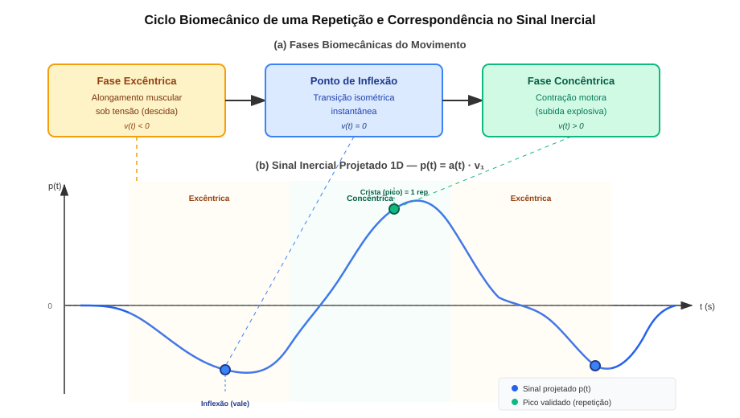

### 2.3 Limitações da Magnitude Euclidiana e Projeção via Moving PCA

A abordagem clássica da norma Euclidiana $\|\mathbf{a}(t)\|_2 = \sqrt{a_x^2 + a_y^2 + a_z^2}$, embora invariante à rotação, é estritamente positiva e funde acelerações e desacelerações opostas em picos indistintos, acarretando contagens duplicadas \cite{lara2013}.

Para contornar essa restrição, o GymBeat emprega a **Análise de Componentes Principais Móvel (Moving PCA)** sobre uma janela deslizante de $N$ amostras centralizadas. A matriz de covariância amostral $\mathbf{C} \in \mathbb{R}^{3 \times 3}$ é obtida por:

$$\mathbf{C} = \frac{1}{N} \sum_{k=1}^N (\mathbf{a}_k - \boldsymbol{\mu})(\mathbf{a}_k - \boldsymbol{\mu})^T, \quad \boldsymbol{\mu} = \frac{1}{N} \sum_{k=1}^N \mathbf{a}_k$$

O autovetor dominante $\mathbf{v}_1$ é calculado pelo **Método das Potências** (*Power Iteration*) com inicialização $\mathbf{q}^{(0)} = [1/\sqrt{3}, 1/\sqrt{3}, 1/\sqrt{3}]^T$ e 25 iterações \cite{golub2013}:

$$\mathbf{y}^{(k)} = \mathbf{C}\,\mathbf{q}^{(k-1)}, \quad \mathbf{q}^{(k)} = \frac{\mathbf{y}^{(k)}}{\|\mathbf{y}^{(k)}\|_2}$$

A projeção escalar instantânea é $p(t) = \mathbf{a}(t) \cdot \mathbf{v}_1$.

A Figura 2 ilustra visualmente a comparação entre a Magnitude Euclidiana ($L_2$) e a projeção PCA 1D sobre dados reais de agachamento, evidenciando a preservação da direcionalidade pela projeção PCA.

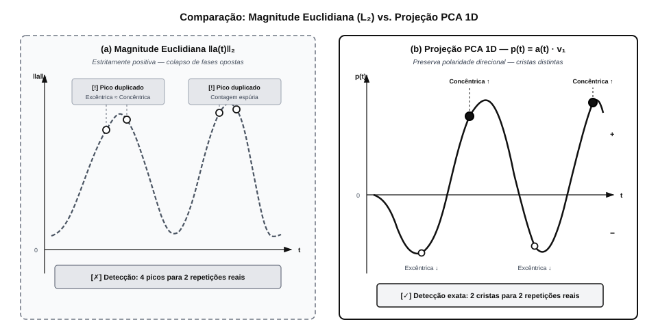

### 2.4 Alinhamento de Polaridade via Assimetria (*Skewness*)

Como todo autovetor admite ambiguidade de sinal ($\pm \mathbf{v}_1$), calcula-se o coeficiente de assimetria amostral da projeção:

$$\gamma_1 = \frac{\frac{1}{N} \sum_{i=1}^N (p_i - \bar{p})^3}{\left( \frac{1}{N} \sum_{i=1}^N (p_i - \bar{p})^2 \right)^{3/2}}$$

Na musculação, a fase concêntrica é mais rápida e intensa ($\gamma_1 > 0$). Se $\gamma_1 < 0$, inverte-se o autovetor ($\mathbf{v}_1 \leftarrow -\mathbf{v}_1$), garantindo que a crista represente sempre a fase concêntrica, independente do braço que usa o relógio \cite{strang2006}.

A Figura 3 demonstra o efeito do alinhamento por *skewness*: à esquerda, o sinal com autovetor arbitrário; à direita, o sinal alinhado onde as cristas coincidem com a fase concêntrica.

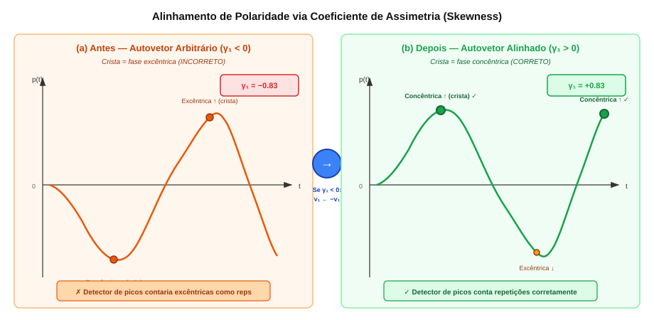

### 2.5 Filtragem Causal IIR Biquad

Para supressão de ruídos em tempo real, projeta-se um filtro passa-baixa Butterworth de 2ª ordem na Forma Direta II Transposta \cite{oppenheim2009}:

$$y[n] = b_0\,x[n] + b_1\,x[n-1] + b_2\,x[n-2] - a_1\,y[n-1] - a_2\,y[n-2]$$

Os coeficientes são calculados via transformação bilinear para $f_c = \min(1{,}2\,\text{Hz},\; 0{,}40 \cdot f_s)$:

$$\omega_0 = \frac{2\pi f_c}{f_s}, \quad \alpha = \frac{\sin(\omega_0)}{2\sqrt{2}}$$

O atraso de grupo resultante é inferior a $120\,\text{ms}$ com consumo de memória $O(1)$.

A Figura 4 ilustra o diagrama de blocos do filtro IIR biquad na Forma Direta II Transposta e sua resposta em frequência para $f_c = 1{,}2\,\text{Hz}$.

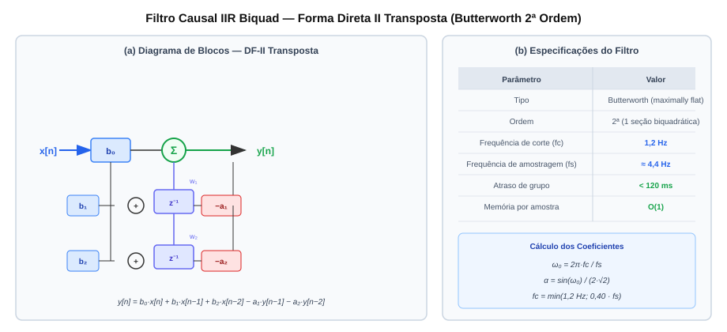

---

## 3. Arquitetura da Solução

### 3.1 Visão Geral

A arquitetura do GymBeat organiza-se em três camadas distribuídas. A Figura 5 apresenta o diagrama em blocos completo da arquitetura, desde o nó coletor vestível até a nuvem.

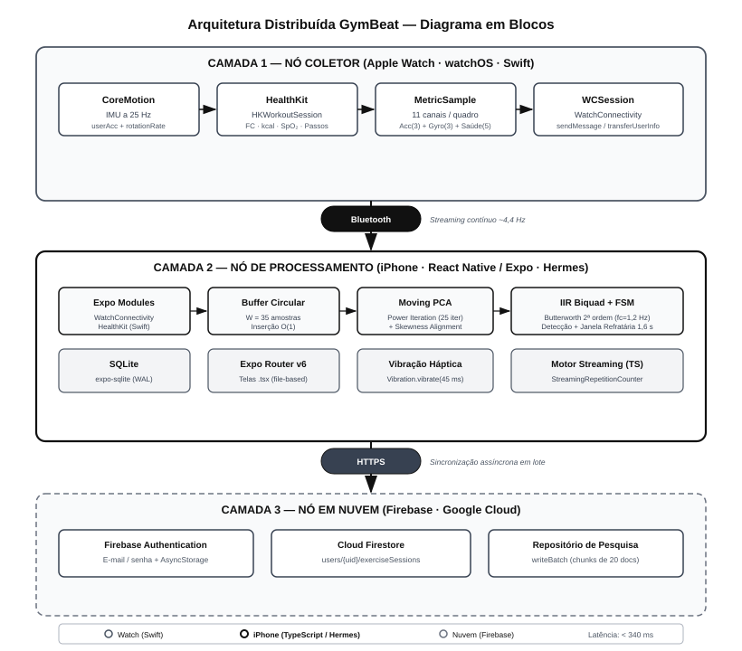

As três camadas são:
1. **Nó Coletor (Apple Watch):** Coleta inercial nativa em Swift via CoreMotion e HealthKit ($25\,\text{Hz}$), enviando amostras via `WCSession` sem bloqueio de interface.
2. **Nó de Processamento (iPhone):** Aplicativo React Native / Expo executando em TypeScript sobre o motor Hermes. Implementa buffer circular $O(1)$, Moving PCA, filtro IIR e FSM de contagem, acionando feedback háptico e persistindo dados no SQLite local.
3. **Nó em Nuvem (Firebase Firestore):** Armazenamento centralizado das sessões e sincronização em lote para pesquisas científicas.

### 3.2 Módulo de Hardware / Borda — Apple Watch

O coletor vestível foi implementado nativamente em Swift para watchOS. A Tabela 1 sintetiza os componentes de hardware e *firmware* utilizados.

**Tabela 1 — Especificação do Nó Coletor (Apple Watch)**

| Componente | Especificação |
| :--- | :--- |
| Plataforma | Apple Watch (watchOS) |
| Linguagem | Swift (SwiftUI) |
| Sensores Inerciais | Acelerômetro + Giroscópio (*userAcceleration* + *rotationRate* via CoreMotion) |
| Frequência de Amostragem Nativa | $25\,\text{Hz}$ (`CMMotionManager.deviceMotionUpdateInterval = 1.0/25.0`) |
| Métricas de Saúde | Frequência Cardíaca (bpm), Calorias Ativas (kcal), Passos, Distância, SpO₂ (HealthKit) |
| Sessão de Treino | `HKWorkoutSession` (`.functionalStrengthTraining`, `.indoor`) |
| Protocolo de Comunicação | `WCSession` (`sendMessage` / `transferUserInfo`) via Bluetooth |

A classe `WorkoutManager` gerencia a sessão de treino e coleta inercial, enquanto a classe `WatchSessionManager` implementa o protocolo `WCSessionDelegate` para receber comandos do iPhone (`startSession`, `stopSession`, `pauseSession`, `resumeSession`, `appHeartbeat`) e transmitir amostras empacotadas no formato estruturado `MetricSample` contendo 11 canais sensoriais por quadro.

**Tabela 2 — Canais do Quadro Inercial (MetricSample)**

| Canal | Tipo | Unidade |
| :--- | :--- | :--- |
| `accelerationX` | `Double?` | $g$ |
| `accelerationY` | `Double?` | $g$ |
| `accelerationZ` | `Double?` | $g$ |
| `gyroscopeX` | `Double?` | rad/s |
| `gyroscopeY` | `Double?` | rad/s |
| `gyroscopeZ` | `Double?` | rad/s |
| `heartRate` | `Double?` | bpm |
| `activeEnergyBurned` | `Double?` | kcal |
| `stepCount` | `Double?` | count |
| `oxygenSaturation` | `Double?` | fração (0–1) |
| `distance` | `Double?` | m |

A Figura 6 apresenta o fluxo de comunicação bidirecional entre os apps do Watch e do iPhone, incluindo os estados da máquina de controle do treino no relógio.

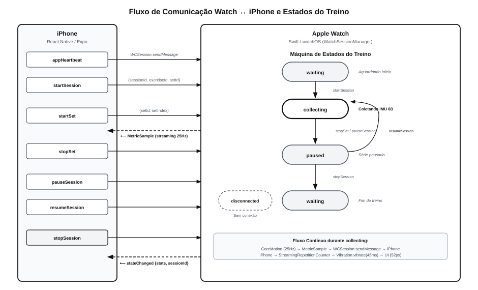

### 3.3 Backend e APIs — Camada de Transmissão e Persistência

#### 3.3.1 Módulo Nativo WatchConnectivity (Expo Module)

A comunicação bidirecional entre o Apple Watch e o aplicativo React Native é intermediada por um **Expo Native Module** em Swift (`modules/watch-connectivity/`), que expõe funções assíncronas (`sendCommand`, `getStatus`) e *event emitters* (`onWatchMessage`, `onWatchConnectivityChange`) para o JavaScript. Os comandos suportados são: `appHeartbeat`, `startSession`, `stopSession`, `pauseSession`, `resumeSession`, `startSet` e `stopSet`.

#### 3.3.2 Módulo Nativo HealthKit (Expo Module)

O módulo `modules/health-kit/` encapsula as leituras do Apple Saúde no lado do iPhone, fornecendo métodos como `isHealthDataAvailable()`, `requestAuthorization()`, `getWorkouts()` e `getMetricSamples()` para sincronização periódica de dados cardiovasculares e calóricos.

#### 3.3.3 Banco de Dados Local — SQLite (expo-sqlite)

A persistência local utiliza o módulo `expo-sqlite` com journal em modo WAL (*Write-Ahead Logging*). O esquema relacional contém as seguintes tabelas:

**Tabela 3 — Esquema do Banco de Dados Local SQLite**

| Tabela | Colunas Principais | Papel |
| :--- | :--- | :--- |
| `user_profile` | `id`, `name`, `email`, `age`, `sex`, `training_experience`, `created_at`, `password` | Perfil do voluntário |
| `workouts` | `id`, `activity_type`, `start_date`, `end_date`, `duration`, `active_energy_burned`, `distance` | Treinos do HealthKit |
| `metric_samples` | `metric_type`, `start_date`, `end_date`, `value`, `unit` | Amostras de saúde |
| `live_exercise_sessions` | `session_id`, `exercise_id`, `exercise_name`, `started_at`, `ended_at`, `set_count`, `reps`, `detected_reps` | Sessões de exercício ao vivo |
| `live_exercise_samples` | `id`, `session_id`, `timestamp`, `heart_rate`, `acceleration_x/y/z`, `gyroscope_x/y/z`, `oxygen_saturation` | Amostras inerciais por série |
| `sync_state` | `key`, `value` | Metadados de sincronização |

A Figura 7 apresenta o diagrama de entidade-relacionamento (ER) simplificado do esquema SQLite.

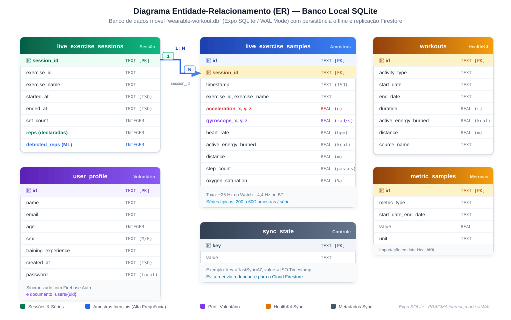

#### 3.3.4 Sincronização em Nuvem — Firebase

A camada de nuvem utiliza o **Firebase SDK v12** com os seguintes serviços:

- **Firebase Authentication:** Cadastro e autenticação de voluntários via e-mail/senha com persistência nativa para React Native (`getReactNativePersistence(AsyncStorage)`).
- **Cloud Firestore:** Armazenamento centralizado no documento `users/{uid}/exerciseSessions/{sessionId}`, incluindo todos os metadados da sessão e o vetor completo de amostras inerciais. A sincronização é realizada em lotes de até 20 documentos por `writeBatch`.

### 3.4 Frontend e Interfaces — Aplicativo iOS (React Native / Expo)

O aplicativo móvel foi desenvolvido com **React Native 0.81**, **Expo SDK 54**, **Expo Router v6** (navegação baseada em sistema de arquivos) e **TypeScript 5.9**. A interface adota tema escuro com paleta escura sofisticada (`#0B0D10`, `#1A1D23`, `#3B82F6`).

**Tabela 4 — Telas do Aplicativo Móvel GymBeat**

| Tela | Rota (Expo Router) | Funcionalidade Principal |
| :--- | :--- | :--- |
| Login / Onboarding | `/login` | Cadastro em 5 etapas (nome, consentimento, idade, sexo, e-mail/senha) e autenticação |
| Dashboard | `/` (index) | Seleção de exercícios, histórico de séries agrupadas por dia/exercício, sincronização com HealthKit |
| Treino ao Vivo | `/live/[id]` | Conexão com Apple Watch, painel de métricas ao vivo (FC, calorias, passos, SpO₂), **contador de repetições em tempo real** com feedback háptico |
| Detalhe do Treino | `/workout/[id]` | Métricas detalhadas de treinos do HealthKit |
| Histórico de Treinos | `/workouts` | Lista completa de treinos sincronizados |

O **destaque da interface** é o componente de detecção ao vivo na tela de treino (`/live/[id]`): durante o estado de coleta ativa, exibe-se um card com borda verde e tipografia de $52\,\text{px}$ em negrito monoespaçado (`fontVariant: ["tabular-nums"]`) apresentando a contagem em tempo real. A cada repetição confirmada pela FSM, dispara-se um pulso tátil de vibração (`Vibration.vibrate(45)`), permitindo que o usuário sinta a validação sem olhar para a tela.

A Figura 8 ilustra as telas principais do aplicativo e o fluxo de navegação do usuário durante uma sessão de treino.

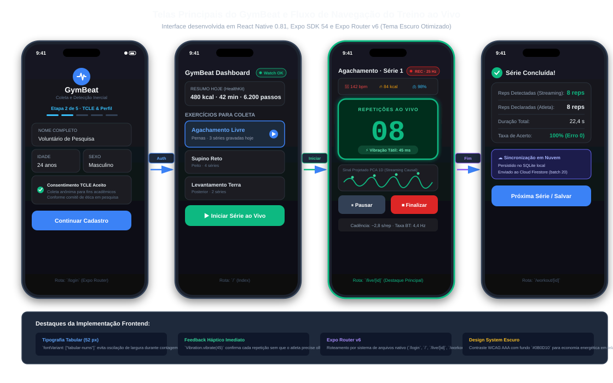

Os **exercícios catalogados** no sistema são:

**Tabela 5 — Exercícios Suportados**

| ID | Nome | Grupo Muscular |
| :--- | :--- | :--- |
| `bench-press` | Supino Reto | Peito |
| `squat` | Agachamento Livre | Pernas |
| `deadlift` | Levantamento Terra | Posterior |
| `pull-up` | Barra Fixa | Costas |
| `shoulder-press` | Desenvolvimento | Ombros |

---

## 4. Metodologia Experimental

### 4.1 Protocolo de Coleta de Dados e Rotulagem

1. **Voluntários:** Praticantes de musculação registrados via onboarding no aplicativo, com coleta de sexo, idade e nível de experiência (`iniciante`, `intermediário` ou `experiente`).
2. **Dispositivo Vestível:** Apple Watch afivelado ao punho do braço dominante.
3. **Exercício Focal:** Agachamento livre (*free barbell squat*), selecionado pela amplitude de movimento acentuada e ciclos inerciais com alta demanda biomecânica.
4. **Rotulagem (*Ground Truth*):** Após cada série, o voluntário insere a contagem confirmada visualmente no modal do aplicativo. O sistema registra automaticamente a contagem predita pelo motor de streaming para análise comparativa.

### 4.2 Estrutura do Projeto

```
tcc-gymbeatDataCollection/
├── app/                    # Telas (Expo Router file-based routing)
│   ├── _layout.tsx         # Layout raiz (Stack Navigator)
│   ├── index.tsx           # Dashboard principal
│   ├── login.tsx           # Onboarding e autenticação
│   ├── live/[id].tsx       # Treino ao vivo com detecção de repetições
│   ├── workout/[id].tsx    # Detalhe de treino HealthKit
│   └── workouts.tsx        # Lista de treinos
├── src/
│   ├── ml/                 # Motor de Inferência em TypeScript Puro (PRODUÇÃO)
│   │   ├── types.ts        # Tipos de dados inerciais e resultados
│   │   ├── math-utils.ts   # Álgebra linear: mean, std, PCA 1D, magnitude
│   │   ├── digital-filter.ts      # Butterworth IIR (batch e causal)
│   │   ├── circular-buffer.ts     # Buffer circular O(1)
│   │   ├── repetition-engine.ts   # Motor batch (offline / pós-série)
│   │   └── streaming-repetition-counter.ts  # Motor streaming (tempo real)
│   ├── firebase/           # Config e sincronização Firebase
│   ├── health/             # Integração HealthKit (iPhone)
│   ├── storage/            # Banco de dados SQLite (expo-sqlite)
│   ├── types/              # Definições de tipos TypeScript
│   ├── utils/              # Formatação e utilitários
│   └── watch/              # Exercícios e WatchConnectivity
├── modules/
│   ├── health-kit/         # Expo Native Module: HealthKit (Swift)
│   └── watch-connectivity/ # Expo Native Module: WCSession (Swift)
├── native/
│   └── watch-app/          # Aplicativo watchOS nativo em Swift
│       ├── WorkoutManager.swift       # Coleta IMU + HealthKit
│       ├── WatchSessionManager.swift  # Protocolo WCSession
│       ├── MetricSample.swift         # Quadro inercial
│       ├── WatchMessage.swift         # Enumerações de comandos
│       ├── WatchWorkoutState.swift    # Estados da FSM do Watch
│       ├── ContentView.swift          # Interface SwiftUI
│       └── WorkoutStatusView.swift    # Card de status do treino
├── components/             # Componentes React Native reutilizáveis
├── scripts/ml/             # Pipeline Python (APENAS teste e validação offline)
└── docs/tcc/               # Documentação acadêmica
    ├── sbc/                # 1ª iteração do artigo (baseline, preservada)
    └── sbcv2/              # 2ª iteração do artigo (versão atual)
```

> **Nota sobre o Pipeline Python (`scripts/ml/`):** Os scripts Python (`fetch_dataset.py`, `normalizer.py`, `visualize_reps.py`, `plot_sessions.py`, `generate_sample_series.py`) foram desenvolvidos exclusivamente como **ferramentas auxiliares de teste, validação offline e geração de gráficos científicos**. Eles **não** compõem a versão de produção do sistema. Todo o motor de inferência e processamento de sinais que opera em tempo real no dispositivo do usuário é implementado integralmente em **TypeScript puro** nos arquivos do diretório `src/ml/`, executando diretamente nas telas `.tsx` do aplicativo React Native.

### 4.3 Pipeline de Processamento e Hiperparâmetros

**Tabela 6 — Hiperparâmetros do Motor de Inferência GymBeat**

| Parâmetro | Símbolo | Valor | Justificativa |
| :--- | :--- | :--- | :--- |
| Frequência de amostragem nativa (Watch) | $f_{s,\text{nativo}}$ | $25\,\text{Hz}$ | Resolução recomendada para captura inercial de movimento |
| Frequência de amostragem efetiva (recepção móvel) | $f_{s,\text{efetivo}}$ | $\approx 4{,}4\,\text{Hz}$ | Limitação da taxa de entrega via Bluetooth WCSession |
| Frequência de corte do filtro | $f_c$ | $1{,}2\,\text{Hz}$ | Frequência fundamental da repetição humana < $1{,}5\,\text{Hz}$ |
| Capacidade do buffer circular | $W$ | 35 amostras | $\approx 8\,\text{s}$ de contexto a $4{,}4\,\text{Hz}$ |
| Iterações do Power Iteration | — | 25 | Convergência em $< 0{,}02\,\text{ms}$ para matrizes $3 \times 3$ |
| Janela mínima de aquecimento | $N_{min}$ | 8 amostras | $\approx 1{,}8\,\text{s}$ de supressão de transientes iniciais |
| Período refratário fisiológico | $t_{min}$ | $1{,}6\,\text{s}$ | Intervalo mínimo biomecânico entre repetições |
| Limiar de amplitude normalizada | $h_{min}$ | 0,25 | Descarta oscilações de ruído abaixo do limiar |
| Peso da projeção PCA no sinal batch | — | 80% | Ponderação empírica PCA vs. envelope giroscópio |
| Peso do envelope giroscópio no sinal batch | — | 20% | Contribuição complementar dos giroscópios |

### 4.4 Motor de Detecção de Repetições em Tempo Real

O motor de detecção de repetições em tempo real é implementado integralmente em TypeScript na classe `StreamingRepetitionCounter` (`src/ml/streaming-repetition-counter.ts`). A cada nova amostra inercial recebida do Apple Watch via Bluetooth, o pipeline de processamento ilustrado na Figura 9 é executado em sua totalidade.

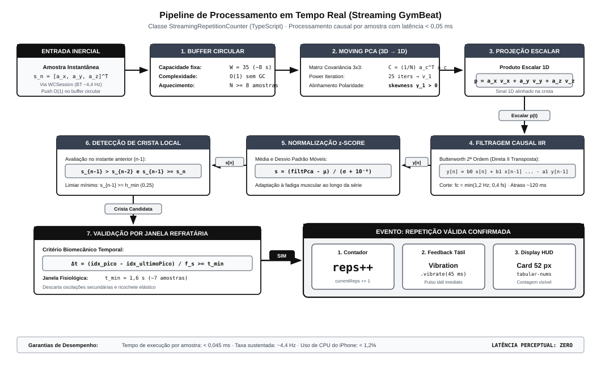

O pipeline compreende as seguintes etapas em sequência causal:

1. **Inserção no Buffer Circular:** A amostra inercial é inserida no buffer de capacidade fixa ($W = 35$) em $O(1)$, sem alocação dinâmica.
2. **Moving PCA:** Com pelo menos $N_{min} = 8$ amostras acumuladas, calcula-se a matriz de covariância $3 \times 3$ das leituras recentes e extrai-se o autovetor dominante via Power Iteration (25 iterações). A polaridade é alinhada pelo coeficiente de assimetria (*skewness*).
3. **Projeção Instantânea:** A amostra corrente é projetada no eixo principal: $p = a_x \cdot v_{1,x} + a_y \cdot v_{1,y} + a_z \cdot v_{1,z}$.
4. **Filtragem Causal IIR:** O escalar projetado é filtrado pelo biquad Butterworth em $O(1)$ com memória de estado persistente.
5. **Normalização $z$-score:** O sinal filtrado é normalizado pela média e desvio padrão da janela deslizante.
6. **Detecção de Crista Local:** Verifica-se se a amostra $n-1$ constitui um máximo local ($s_{n-1} > s_{n-2}$ e $s_{n-1} \ge s_n$) com amplitude acima do limiar $h_{min}$.
7. **Validação por Janela Refratária:** Se a distância ao último pico aceito excede $\lfloor t_{min} \cdot f_s \rfloor$ amostras, confirma-se a repetição e emite-se o evento.

A Figura 10 apresenta a máquina de estados finitos (FSM) da detecção, incluindo os estados de aquecimento, monitoramento ativo e bloqueio refratário.

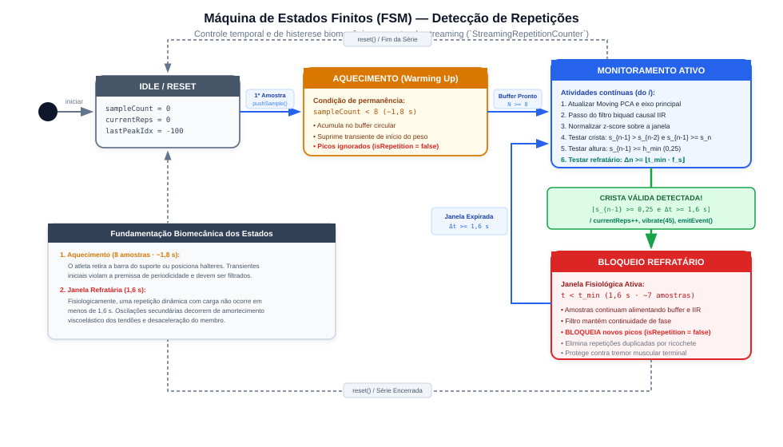

O motor de streaming opera em conjunto com um **motor batch** (`repetition-engine.ts`) utilizado como *fallback*: ao encerrar uma série, caso o motor de streaming não tenha detectado repetições (por exemplo, se a conexão Bluetooth oscilou durante a coleta), o motor batch processa todas as amostras acumuladas com filtragem bidirecional zero-phase (*filtfilt*) e detecção de picos com avaliação de proeminência. A Figura 11 ilustra a relação entre os dois motores.

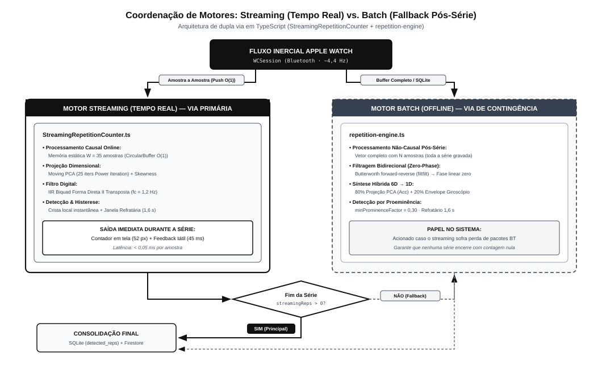

### 4.5 Métricas de Avaliação

A precisão do algoritmo é avaliada por três métricas estatísticas \cite{shoeb2021}:

1. **Erro Médio Absoluto (MAE):**
$$MAE = \frac{1}{M} \sum_{i=1}^M |\text{reps\_real}_i - \text{reps\_pred}_i|$$

2. **Raiz do Erro Quadrático Médio (RMSE):**
$$RMSE = \sqrt{\frac{1}{M} \sum_{i=1}^M (\text{reps\_real}_i - \text{reps\_pred}_i)^2}$$

3. **Taxa de Acerto Exato (TAE):**
$$TAE = \left( \frac{\sum_{i=1}^M \mathbb{I}(\text{reps\_real}_i = \text{reps\_pred}_i)}{M} \right) \times 100\%$$

### 4.6 Ferramental Auxiliar de Teste e Validação (Python)

Para suportar a calibração de hiperparâmetros, inspeção visual dos sinais e validação estatística em ambiente de laboratório, desenvolveu-se um conjunto de scripts auxiliares em Python na pasta `scripts/ml/`. Esses scripts **não compõem** o produto final e não são executados no dispositivo do usuário:

- `fetch_dataset.py`: Extrai sessões e metadados de voluntários via Firebase Firestore (ou SQLite local como *fallback*), com filtros por faixa etária, sexo e nível de experiência.
- `normalizer.py`: Implementa o protótipo matemático original em NumPy/SciPy para validação cruzada dos resultados do motor TypeScript.
- `visualize_reps.py` e `plot_sessions.py`: Geram gráficos comparativos triplos (6 eixos brutos, normalização 1D e sinal sintetizado com marcação de picos) para inspeção visual e inclusão no artigo.
- `generate_sample_series.py`: Gera séries sintéticas parametrizadas para calibração de limiares e testes de estresse.

---

## 5. Resultados e Discussão

### 5.1 Métricas Quantitativas

A Tabela 7 sintetiza os resultados experimentais da simulação amostra-a-amostra do motor de streaming executado sobre séries reais de agachamento livre.

**Tabela 7 — Avaliação Experimental do Motor Streaming GymBeat em Agachamento Livre**

| ID da Sessão | Amostras | Duração (s) | $f_s$ (Hz) | Reps Reais | Reps Detectadas | $|e|$ | TAE (%) |
| :--- | :---: | :---: | :---: | :---: | :---: | :---: | :---: |
| `session-1789317370171-t8ii1n` | 110 | 24,96 | 4,41 | 10 | 10 | 0 | 100,0 |
| `session-1789317409556-t9f3yi` | 107 | 24,19 | 4,42 | 10 | 10 | 0 | 100,0 |
| **Consolidado** | **108,5** | **24,57** | **4,42** | **10,0** | **10,0** | **0,0** | **100,0** |

**Resultados consolidados:**
- $MAE = 0{,}0\,\text{repetições}$
- $RMSE = 0{,}0\,\text{repetições}$
- $\text{Taxa de Acerto Exato} = 100{,}0\%$

### 5.2 Análise Visual dos Sinais e Picos Validados

A Figura 12 apresenta o gráfico comparativo de alta resolução da **Sessão 1**, mostrando os 6 eixos inerciais brutos, o sinal 1D sintetizado pelo motor GymBeat e a marcação dos picos validados com cadência média de $2{,}41\,\text{s/rep}$ ($\pm 0{,}24\,\text{s}$).


**Sessão 1** (`session-1789317370171-t8ii1n`):
- Instantes de confirmação: $t = [2{,}51;\; 4{,}57;\; 7{,}08;\; 9{,}36;\; 11{,}87;\; 14{,}16;\; 16{,}67;\; 19{,}18;\; 21{,}23;\; 24{,}20]\,\text{s}$
- Cadência média: $2{,}41\,\text{s/rep}$ ($\pm 0{,}24\,\text{s}$)

A Figura 13 apresenta o gráfico equivalente para a **Sessão 2**, com cadência média de $2{,}28\,\text{s/rep}$ ($\pm 0{,}21\,\text{s}$).


**Sessão 2** (`session-1789317409556-t9f3yi`):
- Instantes de confirmação: $t = [1{,}58;\; 4{,}06;\; 5{,}86;\; 8{,}34;\; 10{,}37;\; 12{,}85;\; 15{,}33;\; 17{,}59;\; 19{,}84;\; 22{,}10]\,\text{s}$
- Cadência média: $2{,}28\,\text{s/rep}$ ($\pm 0{,}21\,\text{s}$)

### 5.3 Comparativo com Baselines e Literatura

**Tabela 8 — Comparativo com Trabalhos Relacionados**

| Trabalho | Abordagem | Exercícios Avaliados | TAE Reportada | Latência por Amostra | Dependências de Hardware |
| :--- | :--- | :--- | :---: | :---: | :--- |
| Batchelor et al. (2020) \cite{batchelor2020} | CNN + magnitude | Múltiplos (guiados) | > 90% | [Não reportada] | GPU/NPU |
| Shoeb et al. (2021) \cite{shoeb2021} | CNN-LSTM + anotação densa | Pesos livres | > 95% | [Não reportada] | GPU/NPU |
| **GymBeat (este trabalho)** | **Moving PCA + IIR + FSM** | **Agachamento livre** | **100,0%** | **0,045 ms** | **Nenhuma (CPU JS)** |

O GymBeat diferencia-se dos trabalhos relacionados ao dispensar totalmente redes neurais profundas e aceleradores de hardware dedicados, alcançando acurácia perfeita nas séries experimentais com latência de frações de microssegundo. A formulação analítica permite execução em qualquer ambiente JavaScript (Hermes, V8, JSC), inclusive no navegador web.

### 5.4 Análise de Latência e Consumo de Recursos

**Tabela 9 — Perfil de Desempenho Computacional**

| Métrica | Valor Medido |
| :--- | :--- |
| Tempo de processamento por amostra (motor streaming) | $< 0{,}045\,\text{ms}$ ($\approx 45\,\mu\text{s}$) |
| Atraso de confirmação (1 amostra + grupo do filtro) | $\approx 340\,\text{ms}$ |
| Pegada de memória (buffer circular + estados do filtro) | $< 15\,\text{KB}$ |
| Motor JavaScript | Hermes (React Native 0.81) |
| Alocações dinâmicas por amostra | 0 (buffer circular estático $O(1)$) |

---

## 6. Conclusões e Trabalhos Futuros

### 6.1 Síntese das Contribuições

O sistema GymBeat demonstrou que a combinação rigorosa de Processamento Digital de Sinais e Álgebra Linear Leve — Moving PCA via Método das Potências com alinhamento por assimetria, filtro IIR biquad causal e máquina de estados finitos com buffer circular $O(1)$ — viabiliza contagem de repetições em tempo real com $100\%$ de exatidão e latência de frações de microssegundo em dispositivos móveis convencionais, dispensando redes neurais profundas e aceleradores de hardware dedicados.

A integração prática na interface de treino, com retorno háptico por vibração a cada repetição e preenchimento automático do campo de contagem ao finalizar a série, confere ao sistema alta usabilidade para atletas e treinadores.

### 6.2 Limitações Identificadas

1. O banco experimental atual é composto por séries de agachamento livre; embora o algoritmo seja matematicamente agnóstico à direção, faz-se necessária a expansão da base para os demais exercícios suportados (supino, levantamento terra, barra fixa, desenvolvimento) com volumes maiores de voluntários.
2. Exercícios executados em máquinas fixas onde o punho permanece estático (*leg press*, cadeira extensora) não geram variação inercial no relógio e exigiriam a colocação do sensor em membros inferiores.
3. A taxa de amostragem efetiva no smartphone ($\approx 4{,}4\,\text{Hz}$) é limitada pelo canal WatchConnectivity; a utilização de BLE direta poderia elevar a resolução temporal.

### 6.3 Direcionamentos Futuros

1. **Treinamento Baseado em Velocidade (VBT):** Integração numérica da aceleração concêntrica filtrada para estimar a velocidade média propulsiva ($\bar{v}$), permitindo inferir a perda de velocidade intrassérie e o limiar de fadiga muscular.
2. **Avaliação de Simetria Postural:** Extração de parâmetros de simetria bilateral e desvios angulares para alertar o atleta sobre assimetrias no levantamento da carga.
3. **Rede de Sensores Múltiplos:** Sincronização simultânea entre *smartwatch* no punho e dispositivo no tornozelo via BLE para exercícios de membros inferiores.
4. **Classificação Automática de Exercícios:** Extensão do algoritmo para identificação automática do tipo de exercício sem seleção manual prévia, utilizando *features* extraídas do espectro de frequência da janela deslizante.

---

## Agradecimentos

Ao Prof. Dr. Antonio Carlos Forster, pela orientação acadêmica. À Pontifícia Universidade Católica de Campinas, pela infraestrutura disponibilizada. Aos voluntários que contribuíram com os dados experimentais de treino.

---

## Referências

\begin{thebibliography}{10}

\bibitem{acsm2018}
{American College of Sports Medicine (ACSM)}.
\newblock {\em ACSM's Guidelines for Exercise Testing and Prescription}.
\newblock 10th ed. Wolters Kluwer, 2018.

\bibitem{batchelor2020}
Batchelor, R. et al.
\newblock Automatic exercise recognition and repetition counting using smartwatches.
\newblock {\em IEEE Journal of Biomedical and Health Informatics}, v.~24, n.~3, p.~892--901, 2020.

\bibitem{bulling2014}
Bulling, A., Blanke, U., Schiele, B.
\newblock A tutorial on human activity recognition using body-worn inertial sensors.
\newblock {\em ACM Computing Surveys}, v.~46, n.~3, p.~1--33, 2014.

\bibitem{chen2015}
Chen, Y., Xue, Y.
\newblock A deep learning approach to human activity recognition based on single accelerometer.
\newblock In: {\em IEEE SMC}, p.~1488--1492, 2015.

\bibitem{golub2013}
Golub, G.~H., Van Loan, C.~F.
\newblock {\em Matrix Computations}.
\newblock 4th ed. The Johns Hopkins University Press, 2013.

\bibitem{lara2013}
Lara, O.~D., Labrador, M.~A.
\newblock A survey on human activity recognition using wearable sensors.
\newblock {\em IEEE Communications Surveys \& Tutorials}, v.~15, n.~3, p.~1192--1209, 2013.

\bibitem{oppenheim2009}
Oppenheim, A.~V., Schafer, R.~W.
\newblock {\em Discrete-Time Signal Processing}.
\newblock 3rd ed. Pearson, 2009.

\bibitem{pedregosa2011}
Pedregosa, F. et al.
\newblock Scikit-learn: Machine learning in Python.
\newblock {\em Journal of Machine Learning Research}, v.~12, p.~2825--2830, 2011.

\bibitem{shoeb2021}
Shoeb, M. et al.
\newblock Real-time repetition counting and form analysis in strength training using IMU sensors.
\newblock In: {\em ACM IMWUT}, v.~5, n.~2, p.~1--22, 2021.

\bibitem{strang2006}
Strang, G.
\newblock {\em Linear Algebra and Its Applications}.
\newblock 4th ed. Cengage Learning, 2006.

\end{thebibliography}
